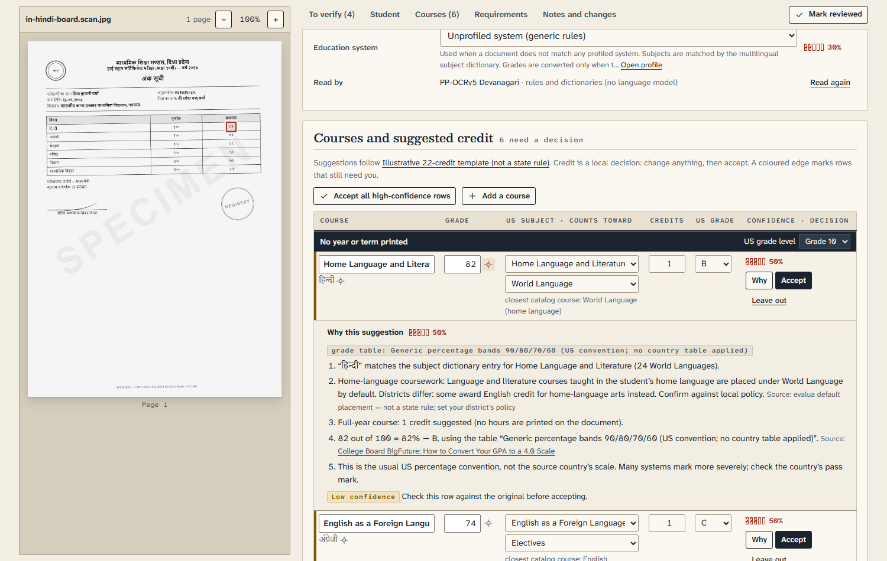

# evalua

Helps US school counselors and registrars evaluate transcripts from international students.

**Live:** https://evalua-5ly.pages.dev

A counselor opens a transcript in any format and language. evalua reads it, structures it, maps each course to the receiving district's graduation requirements, and suggests credit. Every suggestion shows what it matched, why, how confident it is, and the source it relied on, so the counselor can confirm or change it. Credit for coursework done abroad is local policy, so evalua suggests and a person decides.



More screenshots: [case list](docs/screenshots/cases.png), [report](docs/screenshots/report.png). All data shown is fictitious.

## What it does

- **Reads** PDF (text or scanned), Word (.docx), and images (JPG, PNG, HEIC, including skewed phone photos). Several files chosen together (one per term, say) become the pages of one record, and **Add documents** on a case brings in later term reports or missing pages without losing corrections or decisions already made.
- **Extracts** student, school, country and education system, and every course with its grade, credits or hours, year and term. The original text is kept beside an English name, and every field has a confidence score and a link to where it sits on the page.
- **Converts** grades to a US letter, 4.0 points and percentage, naming the conversion table used, and converts hours to Carnegie units.
- **Matches** each course to a subject, then to the district's requirement areas and closest catalog course, and shows what is covered and what is still needed to graduate.
- **Flags items to verify**: unreadable grades, missing years, marks that do not add up to the printed total, ages that do not fit the grade level. It never calls a document fake.
- **Keeps a record per student**: status (uploaded, extracted, reviewed, finalised), notes, and a log of what was changed and by whom.
- **Exports** a print-ready report (save as PDF from the print dialog) and CSV.

### Systems it knows

WAEC (WASSCE, NECO SSCE and school transcripts from The Gambia, Nigeria, Ghana, Sierra Leone, Liberia), GABECE/BECE, JAMB UTME, International Baccalaureate, UK GCSE and A level, India CBSE and CISCE, China, Mexico (SEP), France, Germany, Philippines K to 12, Brazil, South Korea, Vietnam, Russia, Egypt, plus generic rules for anything not profiled. Open **Reference** in the app to see each profile, its grading tables, and where every fact came from.

**Jefferson County Public Schools (Louisville, Kentucky)** ships as a full district profile: Kentucky's 22-credit minimum (704 KAR 3:305), JCPS's own rules (Algebra II, U.S. History and World History by name, the senior Defense of Learning, the civics test), half-credit steps, 120 hours per credit, a catalog of Kentucky state course codes, and JCPS's rules on international transcripts, all linked to their sources. State-minimum templates cover Texas, California, New York, Florida and Washington. A counselor copies a profile, edits the requirements, and adds the district's course catalog by pasting, uploading, or linking it.

### How credit is worked out

Credit follows the work a record documents, not the grades alone.

1. **How much of a year each row covers.** Every system has a school calendar (three terms in The Gambia and Nigeria, two semesters in Mexico, China or Korea). A "Second Term" report documents one third of a year; term reports for the same course add up. If the school confirms the earlier terms were completed, the counselor can tick that, and a second-term report then counts as two thirds of the year.
2. **Which US course the work is.** Mathematics sits on a ladder (Algebra I → Geometry → Algebra II → Pre-Calculus → Calculus), each US course defined by its topics. WAEC General Mathematics is a spiral course, like the US integrated pathway, so year *n* counts as the *n*-th US course; Further Mathematics is placed by its topics. A second year of the same science is further study in it, not a repeat of the same US course.
3. **Rounded to the district's step.** The documented shares of each US course are added up and rounded down to the district's credit step (half a credit per semester at JCPS). One term of three (0.33) earns nothing yet; two terms (0.67) earn one semester (0.5).
4. **Placement.** For each ladder, evalua shows which topics the student's own system is expected to have covered by the date of the record, which US courses that completes, and where to continue. Each step lists the topics covered and still to come.

## Privacy

Transcripts are protected student records, so the design starts there.

- **The transcript never leaves the device.** Reading, OCR, matching and conversion all run in the browser. The server has no endpoint that accepts a transcript.
- **Cases are stored only in the browser** (IndexedDB) until the counselor deletes them.
- **No analytics, trackers, cookies or third-party requests.** Fonts, OCR models and the WebAssembly runtime are served from the site itself. The browser check in `tools/eval/browser.ts` fails if any request goes to another host.
- The shared knowledge base holds reference data only.

The app's Privacy page says the same in plain language.

## Run it

Needs Node 20 or newer.

```bash
npm install
npm run models        # copies the OCR models and WASM runtime into public/ (about 90 MB, not committed)
npm run dev           # http://localhost:5173
```

Other commands:

| Command | What it does |
|---|---|
| `npm run check` | Type-check, lint and unit tests |
| `npm run eval` | Golden set: every fake transcript through the full pipeline; rewrites `docs/ACCURACY.md` |
| `npm run build && npm run eval:browser` | Uploads fakes through the real interface in headless Chromium |
| `npm run fakes` | Regenerates the fictitious transcripts in `fixtures/fake/` |
| `npm run deploy` | Builds, loads the knowledge base into D1, deploys to Cloudflare Pages |

To try the app, use the fictitious transcripts in [`fixtures/fake/`](fixtures/fake). Never test with, or commit, a real one.

## Accuracy

`npm run eval` runs 36 files, rendered from 21 fictitious records, through the pipeline and compares against known answers. Full results, including every miss, are in [`docs/ACCURACY.md`](docs/ACCURACY.md).

| Measure | All 36 files |
|---|---|
| Education system identified | 36/36 |
| Courses found | 98.1% (667/680) |
| Grade correct | 98.1% |
| US grade level correct | 99.9% |
| Subject matched | 99.7% |
| US letter grade correct | 98.2% |

Read these with care. The fakes and the parser were written by the same author, so layouts the generator does not produce are not measured. Text PDFs and Word files are close to perfect; the misses are almost all in scans and photos, where a watermark or glare hides a row or a digit is misread. Real documents will do worse.

## How it works

```
Browser (React + Vite + TypeScript, on Cloudflare Pages)
  src/ingest   file → positioned text tokens
               PDF text layer (pdf.js) · Word (mammoth) · scans, photos, HEIC → OCR in a Web Worker
  src/core     pure TypeScript, no DOM, unit-tested
               layout    tokens → rows and cells (skew-aware)
               tables    header bands, columns, side-by-side and matrix tables → raw courses
               extract   system detection, student and school, years and terms
               convert   grades → US letter, 4.0, percent
               match     course name → subject concept
               evaluate  credit suggestion, requirement progress, reasons and sources
               verify    items for a person to check
  src/kb       knowledge base seed: subject concepts, system profiles, district templates
  src/store    IndexedDB: cases, documents, district profiles, settings
  src/ui       cases · review workspace · report · districts · reference · privacy · settings
Cloudflare Pages Functions + D1
  /api/kb      the shared knowledge base, by school year (reference data only)
  /api/fetch   fetches a public district catalog a counselor linked (https, documents only, size-capped)
  /api/ai/status  whether the host has configured a server-side model (off by default)
```

### Why these choices

- **Everything in the browser.** It is the only design where "the transcript is not on our server" is true by construction, and it costs nothing to run.
- **Rules and dictionaries first, no model assumed.** There are no API keys. Subject matching uses each system profile's course list, then a multilingual dictionary of about 40 subject concepts aligned to NCES SCED subject areas, then fuzzy matching. A model is optional: Settings can point at Ollama on the counselor's own computer, and a host can add a server-side provider later through an environment variable.
- **OCR: PP-OCR models through ONNX Runtime in WebAssembly.** Measured on the fake scans and photos ([`docs/OCR_BENCHMARK.md`](docs/OCR_BENCHMARK.md)): PP-OCR was fastest and handled ruled tables and skewed photos; Tesseract.js lost most table rows; Docling uses the same recogniser family but needs a server; a local vision model read text best but needs a GPU and gives no positions. One detector is shared by seven recognisers (Latin, Chinese and Japanese; Korean; Cyrillic; Arabic; Devanagari; Thai; Greek), and the app switches recogniser when the first one cannot read the page.
- **Image-based deskew.** Phone photos tilt the page, which shifts table rows against each other. A projection-profile estimate on the pixels fixes the row slope before rows are grouped.
- **Print stylesheet for the PDF report.** The browser's own print engine handles every script with the device's fonts and keeps text selectable. Building PDFs in JavaScript would mean shipping large fonts and still not shaping Arabic or Devanagari correctly.
- **Sources on everything.** Each grading table, credit rule and district requirement stores its source link, school year and the date it was added, and the app marks facts that may be out of date.
- **Cloudflare Pages + D1.** Free tier, one deploy. Every hosted file is under the 25 MB Pages limit, which is why the WebAssembly-only ONNX runtime is used instead of the WebGPU one.

### Design

The look comes from registrars' ledgers and transcript paper: deep ink on warm paper, ruled tables with a double rule under the header, status shown as stamps, one vermilion accent. Headings are set in Besley; text and numbers in Atkinson Hyperlegible, chosen because its digits and letters are hard to confuse. It meets WCAG AA contrast, works by keyboard, labels controls for screen readers, and respects reduced-motion settings.

## Limitations

- **It suggests; it does not decide.** US equivalents for grades are conventions, and credit is local policy. The district templates are state minimums, not any district's rules.
- **OCR is imperfect.** Digits in Arabic-Indic and Devanagari numerals are misread more often than Western digits. Stamps and watermarks over a row can hide it. Vietnamese diacritics are often dropped in scans (matching still works; the displayed original loses accents). Handwriting is not supported.
- **Dictionary translation.** English names come from profiles and dictionaries, not a translator. Unknown course names stay in the original language and are flagged.
- **Credit is still a model.** Hours convert at 120 per Carnegie unit when printed; otherwise a full year of a subject is one course. Systems that teach many subjects for few hours each will exceed a normal US year, which evalua flags and can scale down in one click.
- **Curriculum sequences are thin.** Topic-by-year data exists only for WAEC mathematics. No Gambian or Nigerian year-by-year curriculum could be found online, so Ghana's official SHS curriculum (also taught to the WASSCE syllabus) is the reference; Gambian schools may order topics differently. The Further Mathematics year split is evalua's estimate from the syllabus order. Other systems fall back to the usual US grade-level sequence, marked as an assumption with low confidence. Sciences are not yet placed by topic.
- **JCPS details.** The 2025-26 JCPS handbook is the newest found (no 2026-27 edition), so the profile shows as possibly outdated. No district-wide JCPS course catalog was found; the catalog uses Kentucky state course codes, and some (non-AP Pre-Calculus, English Learner, world-language levels) have no code. The "normal year" of 7 credits assumes a seven-period day.
- **Requirements only US coursework can meet** (US history, state assessments, state-specific courses) are not checked.
- **Cases live in one browser.** There are no accounts and no sync. Clearing site data deletes them.
- **Not verified with real records.** All testing used fictitious documents.
- The Florida template figures come from the statute as generally published; the state page could not be fetched for verification when the template was written. Check any template against its linked source.

## How this was built

evalua was directed by Kylar, a high school junior, who set the goals, the privacy rules and the scope, and reviewed the result. The research, design and code were produced with Claude (Anthropic) working from that direction.

## License

MIT. See [LICENSE](LICENSE). OCR models are PaddleOCR (Apache-2.0), converted to ONNX by the ppu-paddle-ocr project.
