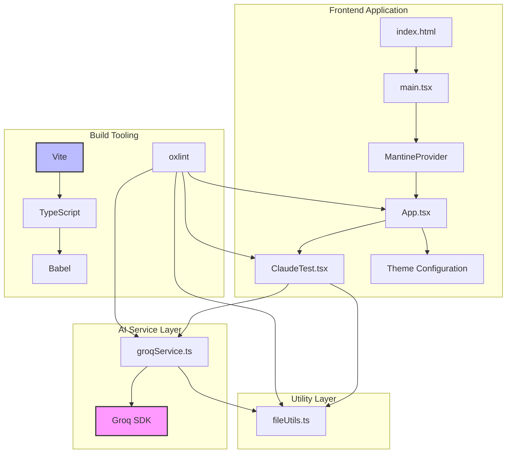

# AI Codebase Guide for Evalua

**Last Updated:** 2026-10-11
**Repository Path:** `evalua/`
**Purpose:** Persistent knowledge base for AI coding agents

---

## Document Purpose and Maintenance Rules

### Intended Audience
This guide is written for AI coding agents performing debugging, feature development, refactoring, testing, and maintenance on the Evalua codebase. It enables agents to understand the project without independently traversing and reanalyzing the entire repository.

### How Agents Should Consult This Guide
1. **Before starting substantial work:** Read the Project Overview, Repository Structure, and Architecture Overview sections
2. **For specific tasks:** Navigate to the File-by-File Reference and Core Workflows sections
3. **After making changes:** Update affected sections immediately (see Maintenance Rules below)
4. **For unfamiliar areas:** Start with the Change Impact Guide to identify relevant files and risks

### Evidence and Verification Requirements
- All claims in this guide are based on inspected source code, configuration files, or repository evidence
- When documentation conflicts with implementation, the discrepancy is noted with evidence
- Unverified behavior is explicitly marked as inference or uncertainty
- Reference file paths use repository-relative paths (e.g., `src/App.tsx`, not absolute paths)

### Freshness and Update Requirements
Future agents **must** update this guide when:
- Adding new files: Add entries to File-by-File Reference and update Repository Structure
- Modifying files: Update descriptions, dependencies, consumers, and behaviors
- Removing files: Remove entries and update Repository Structure
- Changing architecture: Update Architecture Overview, diagrams, and workflows
- Adding dependencies: Update Dependency and Integration Map
- Changing commands: Update Configuration, Commands, and Development Workflow
- Discovering new behavior: Add to relevant sections and record in Maintenance and Change Log

**Rule:** Preserve verified information that remains accurate instead of regenerating the entire guide. Reinspect only the smallest relevant set of files needed to validate a proposed change.

---

## Project Overview

### What Evalua Does
Evalua is a web application designed for schools across the United States to interpret transcripts from international schools into their district's curriculum standards. The application provides:
- Seamless upload processing for transcript files (Word documents, PDFs, images with OCR)
- AI-powered transcript interpretation and analysis
- Credit awarding based on both local and international curricula

**Evidence:** `README.md` lines 1-2; `src/App.tsx` lines 15-16, 26-44

### Main Technologies and Frameworks
- **Frontend Framework:** React 19.2.8 with TypeScript 6.0.2
- **Build Tool:** Vite 8.3.0 with React plugin and Babel (including React Compiler)
- **UI Library:** Mantine UI 9.6.1 (core and hooks)
- **Icons:** Lucide React 1.53.0
- **AI Integration:** Groq SDK 1.6.0 for OCR and text extraction
- **Markdown Rendering:** react-markdown 10.1.0 with rehype-raw and remark-gfm
- **Styling:** PostCSS with Mantine preset
- **Linting:** oxlint 1.81.0

**Evidence:** `package.json` lines 12-38

### Repository-Wide Conventions and Architectural Principles
- **Module System:** ES modules (`"type": "module"` in package.json)
- **TypeScript Configuration:** Project references split into app and node configs
- **Component Organization:** Functional components with hooks
- **UI Theme:** Centralized Mantine theme customization in `src/theme.ts`
- **State Management:** React hooks (useState, useEffect, useRef) - no external state library
- **API Configuration:** Environment variables via Vite (VITE_ prefix)
- **Code Style:** oxlint for linting with React and TypeScript plugins
- **Build Process:** TypeScript compilation followed by Vite build

**Evidence:** `package.json` line 5; `tsconfig.json`; `src/theme.ts`; `.oxlintrc.json`

---

## Repository Structure

### Directory Tree
```
evalua/
├── .env                          # Environment variables (gitignored)
├── .git/                         # Git repository (excluded from analysis)
├── .gitignore                    # Git ignore patterns
├── .oxlintrc.json               # oxlint configuration
├── LICENSE                      # MIT License
├── README.md                    # Project description
├── docs/                        # Documentation directory
│   └── AI_CODEBASE_GUIDE.md    # This file
├── index.html                   # HTML entry point
├── node_modules/               # Dependencies (excluded from analysis)
├── package-lock.json            # Dependency lock file
├── package.json                 # Project manifest and scripts
├── public/                      # Static assets
│   ├── favicon.svg             # Application favicon
│   └── icons.svg               # Social media icons (symbol sprites)
├── src/                         # Source code
│   ├── App.css                  # App-specific styles
│   ├── App.tsx                  # Main application component
│   ├── ClaudeTest.tsx           # Claude API test component
│   ├── assets/                  # Static image assets
│   │   ├── download.jpeg        # Download placeholder image
│   │   └── image.png            # General placeholder image
│   ├── index.css                # Global styles (empty)
│   ├── main.tsx                 # React entry point
│   ├── postcss.config.cjs       # PostCSS configuration
│   ├── services/                # External service integrations
│   │   └── groqService.ts       # Groq SDK wrapper for OCR
│   ├── theme.ts                 # Mantine theme customization
│   └── utils/                   # Utility functions
│       └── fileUtils.ts         # File conversion utilities
├── tsconfig.json                # TypeScript project references
├── tsconfig.app.json            # TypeScript config for app code
├── tsconfig.node.json           # TypeScript config for node scripts
└── vite.config.ts               # Vite build configuration
```

### File Accounting
- **Total files inventoried:** 25 (excluding node_modules and .git)
- **Files inspected:** 21
- **Files excluded from analysis:** 4
  - `node_modules/` - Third-party dependencies (148K+ files)
  - `.git/` - Version control metadata
  - `.env` - Contains secrets (gitignored, access restricted)
  - `package-lock.json` - Dependency lock file (machine-generated, not human-readable)

### Special-Purpose Files
- **Generated files:** None identified in source tree
- **Vendored files:** None
- **Binary assets:** `public/favicon.svg`, `public/icons.svg`, `src/assets/download.jpeg`, `src/assets/image.png` (visual assets, not code)
- **Configuration files:** `.oxlintrc.json`, `tsconfig.json`, `tsconfig.app.json`, `tsconfig.node.json`, `vite.config.ts`, `src/postcss.config.cjs`, `package.json`

---

## Architecture Overview

### Major Subsystems

#### 1. Frontend Application Layer
**Responsibility:** UI rendering, user interaction, and state management
**Components:**
- React application with functional components
- Mantine UI component library for design system
- Custom theme configuration for consistent styling
- File upload and preview functionality

**Evidence:** `src/App.tsx`, `src/main.tsx`, `src/theme.ts`

#### 2. AI Service Integration Layer
**Responsibility:** External AI API communication for OCR and text extraction
**Components:**
- Groq SDK client configuration
- Image-to-text extraction service
- Error handling for rate limits and API failures

**Evidence:** `src/services/groqService.ts`

#### 3. Utility Layer
**Responsibility:** Reusable helper functions for file operations
**Components:**
- Base64 encoding for local and uploaded files
- File reading utilities

**Evidence:** `src/utils/fileUtils.ts`

#### 4. Build and Development Tooling
**Responsibility:** Compilation, bundling, linting, and development server
**Components:**
- Vite development server with HMR
- TypeScript compilation with project references
- Babel transpilation with React Compiler
- oxlint for code quality
- PostCSS for CSS processing

**Evidence:** `vite.config.ts`, `tsconfig.*.json`, `package.json`, `.oxlintrc.json`

### Architectural Boundaries
- **Frontend ↔ AI Services:** Via HTTP requests using Groq SDK
- **Frontend ↔ Build Tools:** Via Vite configuration and TypeScript compilation
- **UI Components ↔ Theme:** Via Mantine Provider and theme customization
- **Utility Layer ↔ Application:** Via direct imports

### Architecture Diagram



---

## Entry Points and Execution Lifecycle

### Application Startup Sequence

#### 1. HTML Entry Point
**File:** `index.html`
**Purpose:** Serves the application shell with a root div
**Behavior:**
- Loads HTML5 document with meta tags
- References favicon from `/favicon.svg`
- Mounts `<div id="root"></div>` for React
- Loads entry script: `/src/main.tsx` as a module

**Evidence:** `index.html` lines 1-12

#### 2. React Entry Point
**File:** `src/main.tsx`
**Purpose:** Initializes React application with Mantine UI
**Execution:**
1. Imports React StrictMode, createRoot, and App component
2. Imports MantineProvider and custom theme
3. Imports Mantine core styles
4. Creates React root on DOM element with id "root"
5. Renders App component wrapped in StrictMode and MantineProvider

**Dependencies:** React, react-dom, @mantine/core
**Consumers:** None (root of component tree)

**Evidence:** `src/main.tsx` lines 1-20

#### 3. Main Application Component
**File:** `src/App.tsx`
**Purpose:** Renders primary UI with feature cards and test component
**Execution:**
1. Renders AppShell layout from Mantine
2. Displays title and description
3. Renders "Get started" button (no functionality implemented)
4. Renders ClaudeTestComponent for AI API testing
5. Displays feature cards in SimpleGrid (some empty/incomplete)

**Dependencies:** React hooks, lucide-react icons, @mantine/core components, ClaudeTestComponent
**Consumers:** main.tsx

**Evidence:** `src/App.tsx` lines 1-67

### Development Server Startup
**Command:** `npm run dev`
**Process:**
1. Vite loads configuration from `vite.config.ts`
2. Applies React plugin and Babel with React Compiler preset
3. Configures proxy for `/api` routes to `https://api.apmix.ai/v1`
4. Starts development server with HMR
5. Serves `index.html` at root URL
6. TypeScript watches for changes (configured via tsconfig.app.json)

**Evidence:** `package.json` line 7; `vite.config.ts` lines 1-22

### Build Process
**Command:** `npm run build`
**Process:**
1. TypeScript compiles source files (tsc -b)
2. Vite bundles application for production
3. Outputs to `dist/` directory
4. Includes asset optimization and minification

**Evidence:** `package.json` line 8

### Linting Process
**Command:** `npm run lint`
**Process:**
1. oxlint scans source files
2. Applies React and TypeScript rules
3. Enforces React Hooks rules
4. Warns on component export issues

**Evidence:** `package.json` line 9; `.oxlintrc.json` lines 1-8

---

## File-by-File Reference

### Root Configuration Files

#### `.env`
**Path:** `.env`
**Purpose:** Environment variables for API keys and configuration
**Status:** Excluded from analysis (gitignored, contains secrets)
**Expected Variables:** Based on code inspection:
- `VITE_GROQ_API_KEY` - Groq SDK API key (used in groqService.ts)
- `VITE_APMIX_BASE_URL` - APMix API base URL (used in ClaudeTest.tsx)
- `VITE_APMIX_API_KEY` - APMix API key (used in ClaudeTest.tsx)

**Evidence:** Referenced in `src/services/groqService.ts` line 4 and `src/ClaudeTest.tsx` lines 17-19

#### `.gitignore`
**Path:** `.gitignore`
**Purpose:** Specifies files and directories to exclude from Git version control
**Patterns:**
- Log files (*.log, npm-debug.log*, yarn-debug.log*, etc.)
- node_modules directory
- Build output (dist, dist-ssr)
- Local files (*.local)
- Editor directories (.vscode, .idea)
- OS files (.DS_Store, *.suo, etc.)
- Environment files (.env)

**Evidence:** `.gitignore` lines 1-26

#### `.oxlintrc.json`
**Path:** `.oxlintrc.json`
**Purpose:** oxlint configuration for code quality
**Rules:**
- React plugin: Enforces Rules of Hooks
- TypeScript plugin: Type checking
- OXC plugin: Core linting
- React-only-export-components: Warns on constant exports

**Dependencies:** oxlint with react, typescript, oxc plugins
**Consumers:** oxlint CLI via `npm run lint`

**Evidence:** `.oxlintrc.json` lines 1-8

#### `LICENSE`
**Path:** `LICENSE`
**Purpose:** MIT License for the project
**Copyright:** 2026 K11Cham
**Content:** Standard MIT license text

**Evidence:** `LICENSE` lines 1-21

#### `README.md`
**Path:** `README.md`
**Purpose:** Project description and overview
**Content:** Brief description of Evalua as a tool for schools to interpret international transcripts

**Evidence:** `README.md` lines 1-2

#### `package.json`
**Path:** `package.json`
**Purpose:** Project manifest, dependencies, and scripts
**Scripts:**
- `dev`: Start Vite development server
- `build`: TypeScript compilation + Vite build
- `lint`: Run oxlint
- `preview`: Preview production build

**Dependencies:**
- Runtime: @mantine/core, @mantine/hooks, groq-sdk, lucide-react, react, react-dom, react-markdown, rehype-raw, remark-gfm
- Development: @babel/core, @rolldown/plugin-babel, @types/*, @vitejs/plugin-react, babel-plugin-react-compiler, oxlint, postcss, postcss-preset-mantine, postcss-simple-vars, typescript, vite

**Allow Scripts:** groq-sdk@1.6.0, fsevents@2.3.3 (script execution permitted)

**Evidence:** `package.json` lines 1-43

#### `package-lock.json`
**Path:** `package-lock.json`
**Purpose:** Dependency lock file for reproducible installs
**Status:** Machine-generated, not analyzed in detail

#### `tsconfig.json`
**Path:** `tsconfig.json`
**Purpose:** TypeScript project references configuration
**Structure:** References two sub-configurations:
- `tsconfig.app.json` for application code
- `tsconfig.node.json` for node scripts (vite.config.ts)

**Evidence:** `tsconfig.json` lines 1-7

#### `tsconfig.app.json`
**Path:** `tsconfig.app.json`
**Purpose:** TypeScript configuration for application source code
**Key Settings:**
- Target: ES2023
- Module: esnext
- JSX: react-jsx
- Module resolution: bundler
- Strict mode with unused parameter/local checks
- Includes: `src/` directory

**Evidence:** `tsconfig.app.json` lines 1-26

#### `tsconfig.node.json`
**Path:** `tsconfig.node.json`
**Purpose:** TypeScript configuration for node scripts (build tooling)
**Key Settings:**
- Target: ES2023
- Module: nodenext
- Types: node
- Includes: `vite.config.ts`

**Evidence:** `tsconfig.node.json` lines 1-23

#### `vite.config.ts`
**Path:** `vite.config.ts`
**Purpose:** Vite build and development server configuration
**Plugins:**
- @vitejs/plugin-react
- Babel with React Compiler preset

**Server Configuration:**
- Proxy `/api` routes to `https://api.apmix.ai/v1`
- Removes `/api` prefix when forwarding

**Dependencies:** @vitejs/plugin-react, @rolldown/plugin-babel, vite
**Consumers:** Vite CLI

**Evidence:** `vite.config.ts` lines 1-22

### Public Assets

#### `public/favicon.svg`
**Path:** `public/favicon.svg`
**Purpose:** Application favicon
**Content:** SVG lightning bolt icon with purple color scheme
**Dimensions:** 48x46
**Status:** Binary asset, not analyzed in detail

**Evidence:** `public/favicon.svg` line 1

#### `public/icons.svg`
**Path:** `public/icons.svg`
**Purpose:** Social media icon sprites
**Icons Included:**
- Bluesky icon
- Discord icon
- Documentation icon
- GitHub icon
- Social icon
- X (Twitter) icon

**Format:** SVG symbol sprites for reusable referencing
**Status:** Binary asset, not analyzed in detail

**Evidence:** `public/icons.svg` lines 1-24

### Source Code - Application Layer

#### `src/index.css`
**Path:** `src/index.css`
**Purpose:** Global CSS styles
**Content:** Empty file
**Status:** No styles defined, placeholder for future global styles

**Evidence:** `src/index.css` line 1

#### `src/main.tsx`
**Path:** `src/main.tsx`
**Purpose:** React application entry point
**Responsibilities:**
- Initialize React application
- Configure Mantine UI provider with custom theme
- Mount App component to DOM

**Internal Structure:**
- Imports: StrictMode, createRoot, App, MantineProvider, theme, Mantine styles
- Function: Creates root and renders App with providers

**Behavior:**
1. Import React and DOM dependencies
2. Import global styles (empty)
3. Import App component
4. Import MantineProvider and custom theme
5. Import Mantine core styles
6. Create root on #root element
7. Render App wrapped in StrictMode and MantineProvider

**Dependencies:** react, react-dom, @mantine/core, src/theme.ts, src/index.css, src/App.tsx
**Consumers:** index.html (loaded as module script)
**Inputs:** None
**Outputs:** Renders React application to DOM

**Evidence:** `src/main.tsx` lines 1-20

#### `src/App.tsx`
**Path:** `src/App.tsx`
**Purpose:** Main application component
**Responsibilities:**
- Render application layout
- Display feature information
- Integrate Claude test component

**Internal Structure:**
- State: Unused imports (useState, useEffect, useRef) - likely leftover from development
- Components: AppShell, Container, Title, Text, Stack, SimpleGrid, Card, Paper, Button
- Icons: ArrowRight from lucide-react
- Sub-component: ClaudeTestComponent

**Behavior:**
1. Renders AppShell layout
2. Displays title "Evalua"
3. Shows description of the tool
4. Renders "Get started" button (no click handler)
5. Renders ClaudeTestComponent for AI API testing
6. Displays feature cards in 2-column grid:
   - Card 1: Seamless upload processing (text content)
   - Card 2: Empty
   - Card 3: Empty
   - Card 4: AI-powered transcript interpretation (text content)
7. Contains commented-out file upload form and markdown rendering code

**Dependencies:** React hooks, lucide-react, @mantine/core, src/ClaudeTest.tsx, src/App.css
**Consumers:** src/main.tsx
**Inputs:** None (no props)
**Outputs:** React component tree

**Known Issues:**
- Unused hook imports (useState, useEffect, useRef)
- "Get started" button has no functionality
- Two feature cards are empty
- File upload form is commented out
- ClaudeTestComponent is rendered in production UI (appears to be a test/debug component)

**Evidence:** `src/App.tsx` lines 1-67

#### `src/App.css`
**Path:** `src/App.css`
**Purpose:** App-specific CSS styles
**Responsibilities:** Styling for form and file upload UI
**Internal Structure:**
- form selector: Flex column layout
- .drop-box class: Drag-and-drop area styling (50% width, centered, bordered, rounded)
- #transcript-input: Hidden file input

**Behavior:** Provides styles for commented-out file upload form in App.tsx

**Dependencies:** None
**Consumers:** src/App.tsx (imported but may not be used with commented-out form)
**Status:** Currently unused (form is commented out in App.tsx)

**Evidence:** `src/App.css` lines 1-19

#### `src/theme.ts`
**Path:** `src/theme.ts`
**Purpose:** Mantine UI theme customization
**Responsibilities:** Define consistent design system with custom sizes, spacing, and component defaults

**Internal Structure:**
- CONTAINER_SIZES: Custom container size breakpoints (xxs to xxl)
- mantineTheme: MantineThemeOverride with:
  - Custom font sizes (xs to 5xl)
  - Custom spacing (3xs to 3xl)
  - Primary color: grape
  - Component overrides: Container, Paper, Card, Select

**Component Overrides:**
- Container: Custom size variables using CONTAINER_SIZES
- Paper: Default padding (md), shadow (xl), radius (md), withBorder (true)
- Card: Default padding (xl), shadow (xl), radius (default), withBorder (true)
- Select: checkIconPosition: right

**Dependencies:** @mantine/core
**Consumers:** src/main.tsx
**Inputs:** None
**Outputs:** MantineThemeOverride object

**Evidence:** `src/theme.ts` lines 1-81

#### `src/postcss.config.cjs`
**Path:** `src/postcss.config.cjs`
**Purpose:** PostCSS configuration for CSS processing
**Plugins:**
- postcss-preset-mantine: Mantine CSS preset
- postcss-simple-vars: CSS variables for Mantine breakpoints

**Variables Defined:**
- mantine-breakpoint-xs: 36em
- mantine-breakpoint-sm: 48em
- mantine-breakpoint-md: 62em
- mantine-breakpoint-lg: 75em
- mantine-breakpoint-xl: 88em

**Dependencies:** postcss-preset-mantine, postcss-simple-vars
**Consumers:** Vite build process
**Status:** Config file (CommonJS format)

**Evidence:** `src/postcss.config.cjs` lines 1-14

#### `src/ClaudeTest.tsx`
**Path:** `src/ClaudeTest.tsx`
**Purpose:** Test component for Claude API with file attachment support
**Responsibilities:** Test Claude (Anthropic) API with image and text file attachments

**Internal Structure:**
- State:
  - prompt: string (user input)
  - response: string (API response)
  - loading: boolean (request state)
  - file: File | null (attachment)
- Function: handleAskClaude - async function to call Claude API

**Behavior:**
1. User enters prompt in textarea
2. User selects file (image/* or .txt)
3. File preview displayed (image or file info)
4. On "Send to Claude" click:
   - Reads file (base64 for images, text for .txt)
   - Constructs content array with file data
   - Hardcoded prompt: "What animal is this? One word only."
   - Calls APMix API (Claude proxy) at VITE_APMIX_BASE_URL
   - Uses model: claude-sonnet-4-6-free
   - Extracts text response from API
   - Displays response or error

**Dependencies:** React (useState), fetch API
**Consumers:** src/App.tsx
**Inputs:** User prompt and file attachment
**Outputs:** API response displayed in UI

**Configuration Required:**
- VITE_APMIX_BASE_URL: API base URL
- VITE_APMIX_API_KEY: API authentication key

**Known Issues:**
- Hardcoded prompt "What animal is this?" (not using user prompt input)
- Prompt state is captured but not used in API call
- Appears to be a test/debug component, not production feature
- Uses APMix proxy instead of direct Anthropic API

**Evidence:** `src/ClaudeTest.tsx` lines 1-144

### Source Code - Service Layer

#### `src/services/groqService.ts`
**Path:** `src/services/groqService.ts`
**Purpose:** Groq SDK wrapper for OCR and text extraction from images
**Responsibilities:** Extract text from images using Groq's vision model

**Internal Structure:**
- Constants:
  - DEFAULT_VISION_MODEL: "qwen/qwen3.8-27b"
- Client: Groq SDK instance with:
  - apiKey from VITE_GROQ_API_KEY
  - dangerouslyAllowBrowser: true (client-side usage)
  - maxRetries: 0 (no retry on rate limit)
- Function: extractTextFromImage(base64DataUrl: string): Promise<string>

**Behavior (extractTextFromImage):**
1. Accepts base64-encoded image data URL
2. Calls Groq chat.completions.create with:
   - Model: qwen/qwen3.8-27b
   - Max tokens: 1000
   - Temperature: 0.1 (low randomness)
   - System prompt: OCR extraction with HTML table formatting
   - Image: base64 data URL
3. Returns extracted text from response
4. Throws error on 429 (rate limit) with specific message
5. Throws original error on other failures

**Dependencies:** groq-sdk
**Consumers:** None in current codebase (service exists but not imported)
**Inputs:** base64DataUrl (string) - base64-encoded image
**Outputs:** Promise<string> - extracted text

**Configuration Required:**
- VITE_GROQ_API_KEY: Groq API key

**Known Issues:**
- Service is defined but not used anywhere in the current codebase
- dangerouslyAllowBrowser: true exposes API key in client-side code (security risk in production)
- maxRetries: 0 may cause transient failures
- System prompt requests JSON output but function returns string

**Evidence:** `src/services/groqService.ts` lines 1-50

### Source Code - Utility Layer

#### `src/utils/fileUtils.ts`
**Path:** `src/utils/fileUtils.ts`
**Purpose:** File conversion utilities for base64 encoding
**Responsibilities:** Convert local paths and uploaded files to base64 format

**Internal Structure:**
- Function: localPathToBase64(imagePath: string): Promise<string>
- Function: uploadedFileToBase64(file: File): Promise<string>

**Behavior (localPathToBase64):**
1. Fetches file from local path
2. Converts response to blob
3. Reads blob as data URL using FileReader
4. Resolves with base64 string

**Behavior (uploadedFileToBase64):**
1. Reads File object as data URL using FileReader
2. Resolves with base64 string
3. Rejects on error

**Dependencies:** None (uses browser APIs: fetch, FileReader)
**Consumers:** None in current codebase (utilities exist but not imported)
**Inputs:**
- localPathToBase64: imagePath (string)
- uploadedFileToBase64: file (File)
**Outputs:** Promise<string> - base64 data URL

**Known Issues:**
- Utilities are defined but not used anywhere in the current codebase
- localPathToBase64 may fail with CORS for local file:// URLs

**Evidence:** `src/utils/fileUtils.ts` lines 1-19

### Source Code - Assets

#### `src/assets/download.jpeg`
**Path:** `src/assets/download.jpeg`
**Purpose:** Download placeholder image
**Status:** Binary asset, not analyzed in detail
**Size:** 2,735 bytes

**Evidence:** File listing in src/assets

#### `src/assets/image.png`
**Path:** `src/assets/image.png`
**Purpose:** General placeholder image
**Status:** Binary asset, not analyzed in detail
**Size:** 26,801 bytes

**Evidence:** File listing in src/assets

---

## Core Workflows and Data Flows

### Workflow 1: Application Initialization

**Sequence:**
1. Browser loads `index.html`
2. Browser executes `/src/main.tsx` as ES module
3. `main.tsx` imports and executes:
   - `./index.css` (empty, no effect)
   - `./App.tsx` (component definition)
   - `./theme.ts` (theme configuration)
   - `@mantine/core/styles.css` (Mantine styles)
4. `main.tsx` creates React root on `#root` element
5. Renders `App` component wrapped in `StrictMode` and `MantineProvider`
6. `App` component renders:
   - AppShell layout
   - Title and description
   - "Get started" button
   - ClaudeTestComponent
   - Feature cards (some empty)

**Files Involved (in order):**
- `index.html` → `src/main.tsx` → `src/theme.ts` → `src/App.tsx` → `src/ClaudeTest.tsx`

**Data Flow:**
- Static content from App.tsx renders to DOM
- No dynamic data or external calls in initialization

**Evidence:** `index.html`, `src/main.tsx`, `src/App.tsx`

### Workflow 2: Claude API Test (ClaudeTest Component)

**Sequence:**
1. User types in textarea (captured in `prompt` state but not used)
2. User selects file (image or .txt)
3. File is captured in `file` state
4. File preview renders (image or file info)
5. User clicks "Send to Claude"
6. `handleAskClaude` function executes:
   - Sets `loading` to true
   - Clears previous `response`
   - If file is image: converts to base64 using FileReader
   - If file is .txt: reads text content
   - Constructs content array with file data
   - Adds hardcoded text: "What animal is this? One word only."
   - Makes POST request to `${VITE_APMIX_BASE_URL}/messages`
   - Headers: Content-Type, Authorization (Bearer token), anthropic-version
   - Body: model, max_tokens, messages array
   - Awaits response
   - Extracts text from response.content array
   - Sets `response` state
   - Sets `loading` to false
7. Response displays in UI

**Files Involved:**
- `src/ClaudeTest.tsx` (entire workflow)

**Data Flow:**
```
User Input (file) → FileReader (base64) → content array → HTTP POST → APMix API → Response → Display
```

**Inputs:**
- File attachment (image or .txt)
- Environment variables: VITE_APMIX_BASE_URL, VITE_APMIX_API_KEY

**Outputs:**
- Text response from Claude API displayed in UI

**External Interactions:**
- HTTP POST to APMix API (proxy for Anthropic Claude)

**Evidence:** `src/ClaudeTest.tsx` lines 10-90

### Workflow 3: Groq OCR Service (Unused)

**Sequence (not currently executed):**
1. Service receives base64 image data URL
2. Calls Groq SDK chat.completions.create
3. Sends image with OCR system prompt
4. Awaits Groq API response
5. Returns extracted text

**Files Involved:**
- `src/services/groqService.ts` (service exists but not called)

**Data Flow:**
```
base64 image → Groq SDK → Groq API → Extracted text
```

**Inputs:**
- base64DataUrl (string)
- Environment variable: VITE_GROQ_API_KEY

**Outputs:**
- Extracted text (string)

**External Interactions:**
- Groq API via SDK

**Status:** **Not integrated** - service is defined but not imported or used anywhere

**Evidence:** `src/services/groqService.ts` lines 11-50

### Workflow 4: Development Build

**Sequence:**
1. User runs `npm run dev`
2. npm executes `vite` command
3. Vite loads `vite.config.ts`
4. Vite applies plugins:
   - @vitejs/plugin-react (React support)
   - Babel with React Compiler preset (compilation optimization)
5. Vite configures proxy:
   - `/api` routes → `https://api.apmix.ai/v1`
   - Strips `/api` prefix
6. Vite starts development server
7. Server watches for file changes
8. TypeScript compiler runs in background (via tsconfig.app.json)
9. Browser loads application at localhost URL
10. HMR updates on file changes

**Files Involved:**
- `package.json` (script definition)
- `vite.config.ts` (configuration)
- `tsconfig.app.json` (TypeScript config)
- All source files (watched)

**Evidence:** `package.json` line 7; `vite.config.ts` lines 1-22

### Workflow 5: Production Build

**Sequence:**
1. User runs `npm run build`
2. npm executes `tsc -b && vite build`
3. TypeScript compiles (tsc -b):
   - Uses tsconfig.json (project references)
   - Compiles src/ with tsconfig.app.json
   - Compiles vite.config.ts with tsconfig.node.json
   - Type checks all files
4. Vite builds:
   - Bundles application
   - Optimizes assets
   - Minifies code
   - Outputs to `dist/` directory
5. Build artifacts ready for deployment

**Files Involved:**
- `package.json` (script definition)
- `tsconfig.json`, `tsconfig.app.json`, `tsconfig.node.json` (TypeScript)
- `vite.config.ts` (Vite configuration)
- All source files (bundled)

**Evidence:** `package.json` line 8

### Workflow 6: Linting

**Sequence:**
1. User runs `npm run lint`
2. npm executes `oxlint`
3. oxlint loads `.oxlintrc.json`
4. oxlint scans source files
5. Applies rules:
   - React Rules of Hooks (error)
   - React only-export-components (warn)
   - TypeScript rules
   - OXC rules
6. Reports violations

**Files Involved:**
- `package.json` (script definition)
- `.oxlintrc.json` (configuration)
- All source files (scanned)

**Evidence:** `package.json` line 9; `.oxlintrc.json` lines 1-8

---

## Dependency and Integration Map

### Internal Module Relationships

```
index.html
  └─> src/main.tsx
       ├─> src/index.css
       ├─> src/App.tsx
       │    ├─> src/App.css
       │    ├─> src/ClaudeTest.tsx
       │    └─> @mantine/core components
       ├─> src/theme.ts
       │    └─> @mantine/core
       └─> @mantine/core/styles.css

src/services/groqService.ts (unused)
  └─> groq-sdk

src/utils/fileUtils.ts (unused)
  └─> (browser APIs only)
```

### External Packages and Services

#### Runtime Dependencies
- **@mantine/core 9.6.1:** UI component library
  - Used in: src/main.tsx, src/App.tsx, src/theme.ts
  - Purpose: Component library and theming

- **@mantine/hooks 9.6.1:** React hooks from Mantine
  - Used in: Not currently imported in any file
  - Purpose: Additional React hooks (unused)

- **groq-sdk 1.6.0:** Groq AI API client
  - Used in: src/services/groqService.ts
  - Purpose: AI API communication for OCR
  - Status: Service defined but not used

- **lucide-react 1.53.0:** Icon library
  - Used in: src/App.tsx (ArrowRight icon)
  - Purpose: UI icons

- **react 19.2.8:** React framework
  - Used in: src/main.tsx, src/App.tsx, src/ClaudeTest.tsx
  - Purpose: UI framework

- **react-dom 19.2.8:** React DOM renderer
  - Used in: src/main.tsx
  - Purpose: DOM rendering

- **react-markdown 10.1.0:** Markdown renderer
  - Used in: Not currently imported in any file
  - Purpose: Markdown rendering (unused)

- **rehype-raw 7.0.0:** HTML in markdown support
  - Used in: Not currently imported in any file
  - Purpose: Raw HTML in markdown (unused)

- **remark-gfm 4.0.1:** GitHub Flavored Markdown
  - Used in: Not currently imported in any file
  - Purpose: GFM syntax support (unused)

#### Development Dependencies
- **@vitejs/plugin-react 6.1.1:** Vite React plugin
  - Used in: vite.config.ts
  - Purpose: React support in Vite

- **@rolldown/plugin-babel 0.2.3:** Babel plugin for Rolldown
  - Used in: vite.config.ts
  - Purpose: Babel transpilation

- **@babel/core 7.29.7:** Babel core
  - Used in: Build process
  - Purpose: JavaScript transpilation

- **babel-plugin-react-compiler 1.0.0:** React Compiler
  - Used in: vite.config.ts
  - Purpose: React compilation optimization

- **typescript 6.0.2:** TypeScript compiler
  - Used in: Build process
  - Purpose: Type checking and compilation

- **vite 8.3.0:** Build tool and dev server
  - Used in: Build and dev process
  - Purpose: Bundling and HMR

- **oxlint 1.81.0:** Fast linter
  - Used in: Linting process
  - Purpose: Code quality

- **postcss 8.5.28:** CSS processor
  - Used in: Build process
  - Purpose: CSS transformation

- **postcss-preset-mantine 1.18.0:** Mantine PostCSS preset
  - Used in: src/postcss.config.cjs
  - Purpose: Mantine CSS processing

- **postcss-simple-vars 7.0.1:** CSS variables
  - Used in: src/postcss.config.cjs
  - Purpose: CSS variable support

- **@types/* packages:** TypeScript type definitions
  - @types/node 24.13.3
  - @types/react 19.2.18
  - @types/react-dom 19.2.7
  - @types/babel__core 7.20.5
  - Purpose: Type safety

#### External Services and APIs

**Groq API**
- SDK: groq-sdk
- Purpose: OCR and text extraction from images
- Model: qwen/qwen3.8-27b (vision model)
- Environment Variable: VITE_GROQ_API_KEY
- Used in: src/services/groqService.ts
- Status: Service defined but not used

**APMix API (Claude Proxy)**
- Endpoint: https://api.apmix.ai/v1
- Purpose: Anthropic Claude API proxy
- Model: claude-sonnet-4-6-free
- Environment Variables: VITE_APMIX_BASE_URL, VITE_APMIX_API_KEY
- Used in: src/ClaudeTest.tsx
- Status: Active in ClaudeTest component
- Proxy Configuration: Vite proxy at /api routes

**Evidence:** `package.json` lines 12-38; `vite.config.ts` lines 12-20; `src/services/groqService.ts`; `src/ClaudeTest.tsx`

### Configuration and Environment Requirements

#### Required Environment Variables
- `VITE_GROQ_API_KEY`: Groq API key for OCR service
- `VITE_APMIX_BASE_URL`: APMix API base URL (e.g., https://api.apmix.ai/v1)
- `VITE_APMIX_API_KEY`: APMix API authentication key

**Note:** All environment variables use VITE_ prefix for Vite client-side access

**Evidence:** Referenced in `src/services/groqService.ts` line 4 and `src/ClaudeTest.tsx` lines 17-19

#### Runtime Requirements
- Node.js (version not specified, but uses ES2023 target)
- Modern browser with ES2023 support
- Network access for API calls

#### Development Prerequisites
- npm or compatible package manager
- Git (for version control)

**Evidence:** `package.json`; `tsconfig.app.json` line 4

---

## Configuration, Commands, and Development Workflow

### Development Commands

#### Start Development Server
**Command:** `npm run dev`
**Purpose:** Start Vite development server with HMR
**Configuration:** vite.config.ts
**Proxy:** /api routes to https://api.apmix.ai/v1
**Default URL:** http://localhost:5173 (Vite default)

**Evidence:** `package.json` line 7; `vite.config.ts` lines 12-20

#### Build for Production
**Command:** `npm run build`
**Purpose:** Compile TypeScript and bundle for production
**Process:** TypeScript compilation (tsc -b) → Vite build
**Output:** dist/ directory
**Configuration:** tsconfig.json, tsconfig.app.json, tsconfig.node.json, vite.config.ts

**Evidence:** `package.json` line 8

#### Lint Code
**Command:** `npm run lint`
**Purpose:** Run oxlint for code quality checks
**Configuration:** .oxlintrc.json
**Rules:** React Rules of Hooks, TypeScript, OXC rules

**Evidence:** `package.json` line 9; `.oxlintrc.json` lines 1-8

#### Preview Production Build
**Command:** `npm run preview`
**Purpose:** Preview production build locally
**Process:** Serves dist/ directory
**Configuration:** vite.config.ts

**Evidence:** `package.json` line 10

### Configuration Sources

#### Vite Configuration
**File:** `vite.config.ts`
**Purpose:** Build tool and dev server configuration
**Key Settings:**
- React plugin with Babel and React Compiler
- API proxy for /api routes

**Evidence:** `vite.config.ts` lines 1-22

#### TypeScript Configuration
**Files:** `tsconfig.json`, `tsconfig.app.json`, `tsconfig.node.json`
**Purpose:** Type checking and compilation
**Key Settings:**
- Target: ES2023
- JSX: react-jsx
- Strict mode enabled
- Project references for app and node code

**Evidence:** `tsconfig.json`, `tsconfig.app.json`, `tsconfig.node.json`

#### Linting Configuration
**File:** `.oxlintrc.json`
**Purpose:** Code quality rules
**Key Settings:**
- React plugin
- TypeScript plugin
- OXC plugin
- React Hooks rules enforcement

**Evidence:** `.oxlintrc.json` lines 1-8

#### PostCSS Configuration
**File:** `src/postcss.config.cjs`
**Purpose:** CSS processing
**Key Settings:**
- Mantine preset
- CSS variables for breakpoints

**Evidence:** `src/postcss.config.cjs` lines 1-14

#### Theme Configuration
**File:** `src/theme.ts`
**Purpose:** Mantine UI theme customization
**Key Settings:**
- Custom font sizes
- Custom spacing
- Primary color: grape
- Component defaults (Container, Paper, Card, Select)

**Evidence:** `src/theme.ts` lines 1-81

### Setup Prerequisites

1. **Install dependencies:**
   ```bash
   npm install
   ```

2. **Configure environment variables:**
   - Create `.env` file in root directory
   - Add required variables:
     ```
     VITE_GROQ_API_KEY=your_groq_api_key
     VITE_APMIX_BASE_URL=https://api.apmix.ai/v1
     VITE_APMIX_API_KEY=your_apmix_api_key
     ```

3. **Start development server:**
   ```bash
   npm run dev
   ```

**Evidence:** `.env` existence; `package.json` scripts; environment variable references in source code

### Operational Constraints

#### Security Considerations
- **API Keys in Client-Side Code:** Both Groq and APMix API keys are exposed in client-side code (VITE_ prefix). This is acceptable for development but poses security risks in production. Consider server-side proxy for production deployments.
- **dangerouslyAllowBrowser:** Groq SDK is configured with `dangerouslyAllowBrowser: true`, which explicitly allows client-side usage but is not recommended for production.

**Evidence:** `src/services/groqService.ts` line 5

#### Rate Limiting
- **Groq SDK:** Configured with `maxRetries: 0` to prevent retry spam on rate limits
- **Groq Service:** Throws specific error message on 429 status
- **No retry logic:** Applications must handle rate limits manually

**Evidence:** `src/services/groqService.ts` lines 6, 45-47

#### Browser Compatibility
- **Target:** ES2023 (requires modern browser)
- **No polyfills:** No explicit polyfill configuration
- **Features:** Uses FileReader, fetch, ES modules

**Evidence:** `tsconfig.app.json` line 4

---

## Testing and Verification

### Test Organization
**Status:** No test files exist in the repository
**Test Framework:** None configured
**Test Files:** 0 files found matching *.test.*, *.spec.*, or test/ directory

**Evidence:** File search for test files returned no results

### Test Commands
**Status:** No test scripts defined in package.json
**Available Commands:**
- `npm run dev` - Development server
- `npm run build` - Production build
- `npm run lint` - Linting
- `npm run preview` - Preview build

**Evidence:** `package.json` lines 6-10 (no test script)

### Behavior Coverage
**Status:** No automated test coverage
**Manual Testing Required:**
- ClaudeTest component functionality
- File upload and preview
- API integration (Groq, APMix)
- UI rendering and responsiveness

**Evidence:** No test infrastructure present

### Important Gaps and Limitations
1. **No Unit Tests:** No unit tests for components, services, or utilities
2. **No Integration Tests:** No end-to-end or integration tests
3. **No Type Tests:** Type safety relies only on TypeScript compilation
4. **No Linting Tests:** Linting is manual (npm run lint)
5. **No Build Verification:** Build success does not guarantee functionality
6. **No API Testing:** API integrations are not tested in isolation
7. **ClaudeTest Component:** Appears to be a debug/test component but is rendered in production UI

**Evidence:** Complete absence of test files and test infrastructure

### Verification Requirements
**Before Making Changes:**
1. Run `npm run lint` to check code quality
2. Run `npm run build` to verify TypeScript compilation and bundling
3. Manually test affected features in development server
4. Verify environment variables are configured correctly

**After Making Changes:**
1. Run `npm run lint` to ensure no new violations
2. Run `npm run build` to ensure build succeeds
3. Manual testing of modified features
4. Update this guide if architecture or behavior changes

**Evidence:** Available scripts and current development practices

---

## Known Issues, Risks, and Uncertainties

### Confirmed Technical Debt

#### 1. Unused Dependencies
**Issue:** Several dependencies are installed but not used in the codebase
**Affected Packages:**
- @mantine/hooks (not imported anywhere)
- react-markdown (not imported anywhere)
- rehype-raw (not imported anywhere)
- remark-gfm (not imported anywhere)

**Impact:** Increases bundle size and dependency surface
**Evidence:** `package.json` lines 14, 19-21; grep search for imports returned no results

#### 2. Unused Source Code
**Issue:** Services and utilities are defined but not used
**Affected Files:**
- `src/services/groqService.ts` - OCR service, not imported
- `src/utils/fileUtils.ts` - File utilities, not imported

**Impact:** Dead code, unclear if intended for future use or abandoned
**Evidence:** File search for imports of these modules returned no results

#### 3. Unused Imports in App.tsx
**Issue:** React hooks imported but not used
**Affected Code:**
- `useState` - imported but not used
- `useEffect` - imported but not used
- `useRef` - imported but not used

**Impact:** Dead code, linter should flag (may be suppressed)
**Evidence:** `src/App.tsx` line 3; hooks not used in component

#### 4. Incomplete UI Components
**Issue:** Feature cards are empty or non-functional
**Affected Code:**
- "Get started" button has no click handler
- Two feature cards are completely empty
- File upload form is commented out

**Impact:** Incomplete user experience, placeholder content
**Evidence:** `src/App.tsx` lines 18, 33, 37, 47-52

#### 5. ClaudeTest Component in Production UI
**Issue:** Test/debug component is rendered in main App component
**Affected Code:** ClaudeTestComponent rendered in src/App.tsx
**Impact:** Exposes test functionality to end users, not appropriate for production
**Evidence:** `src/App.tsx` line 21

#### 6. Hardcoded Prompt in ClaudeTest
**Issue:** User prompt input is captured but not used
**Affected Code:** Line 48 in ClaudeTest.tsx uses hardcoded "What animal is this? One word only." instead of user's prompt state
**Impact:** User input is ignored, component is not functional as intended
**Evidence:** `src/ClaudeTest.tsx` lines 5, 48, 99-102

#### 7. App.css Unused
**Issue:** App.css is imported but styles are for commented-out form
**Affected Code:** src/App.css styles for .drop-box and #transcript-input
**Impact:** Unused CSS, increases bundle size
**Evidence:** `src/App.tsx` line 1 (imported); `src/App.tsx` lines 47-52 (form commented out)

### Security Risks

#### 1. Client-Side API Keys
**Risk:** API keys exposed in browser client-side code
**Affected:**
- VITE_GROQ_API_KEY in src/services/groqService.ts
- VITE_APMIX_API_KEY in src/ClaudeTest.tsx

**Impact:** Keys visible in browser dev tools, potential for abuse
**Recommendation:** Use server-side proxy for API calls in production
**Evidence:** `src/services/groqService.ts` line 4; `src/ClaudeTest.tsx` line 19

#### 2. dangerouslyAllowBrowser
**Risk:** Groq SDK explicitly configured for browser usage
**Affected:** src/services/groqService.ts line 5
**Impact:** Explicitly allows insecure client-side usage
**Recommendation:** Move API calls to server-side in production
**Evidence:** `src/services/groqService.ts` line 5

### Architectural Risks

#### 1. No Error Boundaries
**Risk:** No React error boundaries to catch component errors
**Impact:** Application crashes on component errors, poor user experience
**Evidence:** No error boundary components found in codebase

#### 2. No Loading States for Main App
**Risk:** No loading indicators for async operations
**Impact:** Poor UX during API calls or data fetching
**Evidence:** No loading state in src/App.tsx

#### 3. No Form Validation
**Risk:** File upload and input forms have no validation
**Impact:** Invalid data may be submitted, poor UX
**Evidence:** No validation logic in ClaudeTest.tsx or commented-out form

#### 4. Mixed API Integrations
**Risk:** Application uses two different AI services (Groq and APMix/Claude)
**Affected:** groqService.ts and ClaudeTest.tsx
**Impact:** Unclear which service is intended for production, potential confusion
**Evidence:** Both services exist but are unrelated

### Unresolved Questions and Uncertainties

#### 1. Intended AI Service
**Question:** Which AI service is intended for production (Groq or APMix/Claude)?
**Evidence:** Both services exist but serve different purposes. Groq is for OCR, APMix is for general Claude queries. Unclear if both are needed or if one is a test.

#### 2. ClaudeTest Component Purpose
**Question:** Is ClaudeTest a temporary debug component or a permanent feature?
**Evidence:** Named "Test", uses hardcoded prompt, rendered in production UI. Suggests temporary but unclear.

#### 3. Feature Cards Completion
**Question:** Are empty feature cards placeholders for future features?
**Evidence:** Two cards are completely empty, no comments explaining intent.

#### 4. File Upload Implementation
**Question:** Why is the file upload form commented out?
**Evidence:** Form exists in code but is commented out with no explanation.

#### 5. FileUtils.localPathToBase64 Use Case
**Question:** When would localPathToBase64 be used in a browser app?
**Evidence:** Function accepts file path but browsers cannot access local file system due to security. May only work with local development server.

#### 6. Theme Breakpoint Usage
**Question:** Are custom breakpoints in postcss.config.cjs actually used?
**Evidence:** Variables defined but no evidence of usage in components or CSS.

### Incomplete Implementations

#### 1. OCR Integration
**Status:** Service defined but not integrated
**File:** src/services/groqService.ts
**Evidence:** Service exists but no imports or calls found

#### 2. File Upload Workflow
**Status:** Partially implemented (commented out)
**File:** src/App.tsx lines 47-52
**Evidence:** Form code exists but is commented out

#### 3. Markdown Rendering
**Status:** Dependencies installed but not used
**Dependencies:** react-markdown, rehype-raw, remark-gfm
**Evidence:** Packages in package.json but no imports found

#### 4. "Get Started" Button
**Status:** Button exists but has no functionality
**File:** src/App.tsx line 18
**Evidence:** Button component with no onClick handler

---

## Change Impact Guide

### Modifying AI Integrations

#### Groq OCR Service
**Files Involved:**
- `src/services/groqService.ts` (primary)
- `.env` (API key configuration)

**Dependencies:**
- groq-sdk package
- VITE_GROQ_API_KEY environment variable

**Consumers:**
- Currently none (service unused)

**Side Effects:**
- If integrated, will affect any component using OCR
- Changes to model or prompt will affect extraction results

**Regression Risks:**
- API key expiration or rate limits
- Model availability changes
- Prompt changes affecting output format

**Verification Steps:**
1. Test with sample images
2. Verify JSON parsing (if output format changes)
3. Check rate limit handling

**Evidence:** `src/services/groqService.ts`

#### Claude API Integration
**Files Involved:**
- `src/ClaudeTest.tsx` (primary)
- `vite.config.ts` (proxy configuration)
- `.env` (API keys)

**Dependencies:**
- fetch API
- VITE_APMIX_BASE_URL, VITE_APMIX_API_KEY

**Consumers:**
- `src/App.tsx` (renders ClaudeTestComponent)

**Side Effects:**
- Changes to API endpoint or model will affect ClaudeTest component
- Proxy configuration changes affect /api routes

**Regression Risks:**
- API endpoint changes
- API key issues
- Proxy misconfiguration
- Model availability (claude-sonnet-4-6-free)

**Verification Steps:**
1. Test file upload and API call
2. Verify response parsing
3. Check proxy configuration
4. Test with both image and text files

**Evidence:** `src/ClaudeTest.tsx`, `vite.config.ts`

### Modifying UI Components

#### Main App Component
**Files Involved:**
- `src/App.tsx` (primary)
- `src/App.css` (styles, if uncommenting form)
- `src/theme.ts` (if changing theme usage)

**Dependencies:**
- React hooks
- @mantine/core components
- lucide-react icons
- ClaudeTestComponent

**Consumers:**
- `src/main.tsx` (renders App)

**Side Effects:**
- Changes affect entire application layout
- Removing ClaudeTestComponent removes API test functionality
- Uncommenting form requires re-enabling App.css

**Regression Risks:**
- Breaking Mantine component API changes
- Theme configuration conflicts
- Layout issues on different screen sizes

**Verification Steps:**
1. Run `npm run lint`
2. Run `npm run build`
3. Manual visual testing
4. Test responsive behavior

**Evidence:** `src/App.tsx`, `src/main.tsx`

#### Theme Configuration
**Files Involved:**
- `src/theme.ts` (primary)
- `src/postcss.config.cjs` (if changing breakpoints)

**Dependencies:**
- @mantine/core

**Consumers:**
- `src/main.tsx` (provides theme to app)

**Side Effects:**
- Changes affect all Mantine components
- Container size changes affect layout
- Spacing changes affect component spacing

**Regression Risks:**
- Breaking theme API changes
- Layout shifts from size/spacing changes
- Color scheme changes affecting accessibility

**Verification Steps:**
1. Visual inspection of all components
2. Test responsive behavior
3. Check contrast ratios (if changing colors)

**Evidence:** `src/theme.ts`, `src/main.tsx`

### Modifying Build Configuration

#### Vite Configuration
**Files Involved:**
- `vite.config.ts` (primary)
- `package.json` (scripts)

**Dependencies:**
- @vitejs/plugin-react
- @rolldown/plugin-babel
- vite

**Consumers:**
- Build and dev processes

**Side Effects:**
- Plugin changes affect compilation
- Proxy changes affect API calls
- Build output changes affect deployment

**Regression Risks:**
- Build failures
- HMR issues in dev
- Proxy misconfiguration
- Bundle size changes

**Verification Steps:**
1. Run `npm run dev` and verify HMR
2. Run `npm run build` and verify output
3. Test API proxy if changed
4. Check bundle size

**Evidence:** `vite.config.ts`, `package.json`

#### TypeScript Configuration
**Files Involved:**
- `tsconfig.json`
- `tsconfig.app.json`
- `tsconfig.node.json`

**Dependencies:**
- typescript package

**Consumers:**
- Build process
- IDE type checking

**Side Effects:**
- Strictness changes affect error reporting
- Target changes affect browser compatibility
- Include/exclude changes affect build scope

**Regression Risks:**
- Type errors preventing build
- Breaking changes from target changes
- Missing files from build

**Verification Steps:**
1. Run `npm run build`
2. Check for type errors
3. Verify all expected files are included

**Evidence:** `tsconfig.json`, `tsconfig.app.json`, `tsconfig.node.json`

### Adding New Features

#### Adding New Components
**Files Involved:**
- New component file (e.g., `src/NewComponent.tsx`)
- `src/App.tsx` (to render new component)
- Possibly `src/theme.ts` (if component needs theme customization)

**Dependencies:**
- React
- @mantine/core (likely)

**Consumers:**
- `src/App.tsx` or other components

**Steps:**
1. Create component file
2. Import in parent component
3. Render in appropriate location
4. Add any required styles to theme
5. Test in development

**Verification Steps:**
1. Run `npm run lint`
2. Run `npm run build`
3. Manual testing
4. Update this guide

**Evidence:** Component pattern in `src/App.tsx`, `src/ClaudeTest.tsx`

#### Adding New Services
**Files Involved:**
- New service file (e.g., `src/services/newService.ts`)
- `.env` (if API keys needed)
- Component files (to use service)

**Dependencies:**
- External SDKs or fetch API

**Consumers:**
- Components requiring the service

**Steps:**
1. Create service file
2. Configure API client
3. Add environment variables to .env
4. Import and use in components
5. Add error handling

**Verification Steps:**
1. Test service in isolation
2. Test integration with components
3. Verify error handling
4. Update this guide

**Evidence:** Service pattern in `src/services/groqService.ts`

### Removing Unused Code

#### Removing Unused Dependencies
**Files Involved:**
- `package.json` (remove dependency)
- `package-lock.json` (regenerate)

**Dependencies:**
- npm

**Steps:**
1. Verify dependency is not used (grep for imports)
2. Remove from package.json
3. Run `npm install` to update lock file
4. Run `npm run build` to verify no breaks

**Verification Steps:**
1. `npm run build` succeeds
2. No import errors
3. Bundle size reduced

**Evidence:** Unused dependencies identified in Known Issues

#### Removing Unused Source Files
**Files Involved:**
- File to remove
- Files importing it (must update)

**Steps:**
1. Search for imports of the file
2. Remove imports from consuming files
3. Delete the file
4. Run `npm run build`

**Verification Steps:**
1. `npm run build` succeeds
2. No missing import errors
3. Functionality still works

**Evidence:** Unused services identified in Known Issues

---

## Maintenance and Change Log

### Initial Creation
**Date:** 2026-10-11
**Affected Sections:** All sections
**Reason:** Initial comprehensive codebase analysis and documentation creation
**Agent:** Devin AI coding agent
**Changes:** Created complete AI_CODEBASE_GUIDE.md from scratch

### Verification Steps Performed
1. **File Inventory:** Complete directory listing and file identification
2. **File Inspection:** Read and analyzed all 21 in-scope files
3. **Dependency Analysis:** Examined package.json and imports across codebase
4. **Architecture Mapping:** Traced component relationships and data flows
5. **Configuration Review:** Analyzed all configuration files
6. **Cross-Reference Verification:** Verified imports, exports, and references
7. **Usage Verification:** Confirmed which files are actually used vs. unused
8. **Evidence Documentation:** Cited specific file locations for all claims

### Files Inventoried
**Total:** 25 files (excluding node_modules and .git)
**Inspected:** 21 files
**Excluded:** 4 files (.env, node_modules, .git, package-lock.json)

### Major Architectural Areas Analyzed
1. Frontend Application Layer (React + Mantine)
2. AI Service Integration Layer (Groq SDK, Claude API)
3. Utility Layer (file conversion)
4. Build and Development Tooling (Vite, TypeScript, Babel, oxlint)

### Core Workflows Documented
1. Application Initialization
2. Claude API Test (ClaudeTest component)
3. Groq OCR Service (unused)
4. Development Build
5. Production Build
6. Linting

### Validation Results
- **File accounting:** All files accounted for in File-by-File Reference
- **Cross-file relationships:** Verified through import analysis
- **Architecture diagrams:** Created based on actual code structure
- **Command verification:** All commands verified against package.json
- **Dependency mapping:** All dependencies traced to usage
- **Evidence standards:** All claims backed by file references

### Remaining Uninspected Files
None - all in-scope files have been inspected.

### Unresolved Questions
See "Known Issues, Risks, and Uncertainties" section for documented uncertainties.

### Limitations
- Binary assets (images, SVGs) not analyzed in detail
- node_modules not inspected (third-party dependencies)
- .git metadata not inspected
- package-lock.json not analyzed (machine-generated)
- No runtime testing performed (static analysis only)

---

## Appendix: Quick Reference

### File Locations by Category

**Entry Points:**
- HTML: `index.html`
- React: `src/main.tsx`
- App: `src/App.tsx`

**Configuration:**
- Build: `vite.config.ts`
- TypeScript: `tsconfig.json`, `tsconfig.app.json`, `tsconfig.node.json`
- Linting: `.oxlintrc.json`
- Styles: `src/postcss.config.cjs`
- Theme: `src/theme.ts`
- Environment: `.env` (gitignored)

**Components:**
- Main: `src/App.tsx`
- Test: `src/ClaudeTest.tsx`

**Services:**
- Groq OCR: `src/services/groqService.ts`

**Utilities:**
- File conversion: `src/utils/fileUtils.ts`

**Styles:**
- Global: `src/index.css` (empty)
- App: `src/App.css`
- Mantine: `@mantine/core/styles.css` (imported in main.tsx)

**Assets:**
- Public: `public/favicon.svg`, `public/icons.svg`
- Source: `src/assets/download.jpeg`, `src/assets/image.png`

### Environment Variables
- `VITE_GROQ_API_KEY` - Groq API key
- `VITE_APMIX_BASE_URL` - APMix API base URL
- `VITE_APMIX_API_KEY` - APMix API key

### npm Scripts
- `npm run dev` - Start development server
- `npm run build` - Build for production
- `npm run lint` - Run linter
- `npm run preview` - Preview production build

### Key External Services
- Groq API (OCR): https://groq.com
- APMix API (Claude proxy): https://api.apmix.ai/v1
- Anthropic Claude API (via APMix proxy)

### Important File Sizes
- `src/assets/image.png`: 26,801 bytes
- `src/assets/download.jpeg`: 2,735 bytes
- `public/favicon.svg`: 9,522 bytes
- `public/icons.svg`: 5,055 bytes

### Technology Stack Summary
- **Frontend:** React 19.2.8, TypeScript 6.0.2
- **Build:** Vite 8.3.0, Babel, React Compiler
- **UI:** Mantine 9.6.1, Lucide React 1.53.0
- **AI:** Groq SDK 1.6.0, Anthropic Claude (via APMix)
- **Linting:** oxlint 1.81.0
- **Styling:** PostCSS with Mantine preset

---

**End of AI Codebase Guide**
