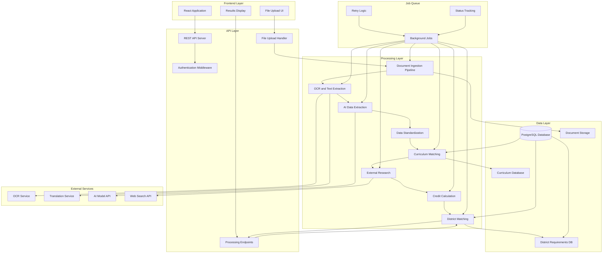

# Transcript Processing and Curriculum-to-US-Credit Matching Implementation Plan

**Document Version:** 1.0
**Date:** 2026-10-11
**Purpose:** Technical implementation plan for backend transcript processing system
**Status:** Planning Phase (No implementation yet)

---

## Table of Contents
1. [Current-State Analysis](#current-state-analysis)
2. [Proposed Architecture](#proposed-architecture)
3. [Data Model and JSON Schema](#data-model-and-json-schema)
4. [Processing Pipeline](#processing-pipeline)
5. [AI and Tool Strategy](#ai-and-tool-strategy)
6. [Curriculum Research and Verification](#curriculum-research-and-verification)
7. [District-Matching Methodology](#district-matching-methodology)
8. [API Design](#api-design)
9. [Implementation Roadmap](#implementation-roadmap)
10. [Risks and Unresolved Questions](#risks-and-unresolved-questions)

---

## 1. Current-State Analysis

### 1.1 Existing Codebase Assessment

**Architecture Type:** Frontend-only React application (no backend infrastructure)

**Current Components:**
- `src/App.tsx` - Main UI component (minimal functionality)
- `src/ClaudeTest.tsx` - Claude API test component (debug tool, not production)
- `src/services/groqService.ts` - Groq SDK wrapper for OCR (defined but unused)
- `src/utils/fileUtils.ts` - File conversion utilities (defined but unused)
- `src/theme.ts` - Mantine UI theme configuration

**Existing AI Integrations:**
- Groq SDK 1.6.0 (configured for client-side OCR, unused)
- APMix API proxy for Anthropic Claude (used in test component only)

**Current Limitations:**
- No backend server or API endpoints
- No database or persistence layer
- No document storage or processing infrastructure
- No data models for transcripts, curricula, or school districts
- No authentication or authorization system
- No job queue for long-running processes
- No curriculum database
- No credit calculation logic
- No district matching system
- No error handling or validation infrastructure

**Build Configuration:**
- Vite 8.3.0 for frontend bundling
- TypeScript 6.0.2 for type safety
- oxlint 1.81.0 for linting
- No backend build configuration

**Security Concerns:**
- API keys exposed in client-side code (VITE_GROQ_API_KEY, VITE_APMIX_API_KEY)
- Groq SDK configured with `dangerouslyAllowBrowser: true`
- No server-side API proxy
- No file validation or security controls

### 1.2 Reusable Components

**Can Be Reused:**
- Frontend React application structure (as UI layer)
- Mantine UI component library (for future UI development)
- TypeScript configuration (can extend for backend)
- Build tooling (Vite for frontend, will need separate backend build)

**Cannot Be Reused (Backend Required):**
- All document processing logic (requires server-side implementation)
- Database operations (no database exists)
- API endpoints (no backend server)
- Job processing (no queue infrastructure)
- File storage (no storage backend)
- Authentication (no auth system)

**Decision Required:** Backend Technology Stack
- **Option A:** Node.js + Express (TypeScript) - Aligns with existing TypeScript, easy integration
- **Option B:** Node.js + Fastify (TypeScript) - Faster, modern alternative
- **Option C:** Python + FastAPI - Better for AI/ML workloads, but adds language complexity
- **Option D:** Go - High performance, but diverges from existing stack

**Recommendation:** Node.js + Express (TypeScript) to maintain consistency with existing frontend TypeScript codebase and simplify full-stack development.

### 1.3 Integration Points

**Frontend-Backend Communication:**
- Current: None (frontend-only)
- Proposed: REST API endpoints or GraphQL API
- Authentication: JWT tokens or session-based auth
- File uploads: Multipart/form-data or streaming uploads

**External Service Integration:**
- OCR: Groq SDK (current) or alternative (Tesseract, Google Vision, Azure Vision)
- Translation: Google Translate API, DeepL API, or AI-based translation
- AI extraction: Claude, GPT-4, or specialized document AI
- Web research: SerpApi, Google Custom Search, or AI-assisted browsing
- Storage: AWS S3, Google Cloud Storage, or local filesystem

**Database Selection (Required):**
- **Option A:** PostgreSQL - Relational, mature, good for structured curriculum data
- **Option B:** MongoDB - Document-oriented, flexible for varying transcript formats
- **Option C:** Hybrid - PostgreSQL for structured data, MongoDB for document storage

**Recommendation:** PostgreSQL for structured data (curricula, districts, users) + document storage service (S3 or local) for file persistence.

---

## 2. Proposed Architecture

### 2.1 System Overview



### 2.2 Architectural Layers

#### Layer 1: Frontend (Existing)
**Responsibility:** User interface, file upload, results display
**Technology:** React 19.2.8, TypeScript, Mantine UI
**Status:** Exists, requires enhancement
**Changes Required:**
- Add file upload component (currently commented out)
- Add processing status display
- Add results visualization
- Connect to backend API endpoints
- Add district selection UI

#### Layer 2: API Layer (New)
**Responsibility:** HTTP request handling, authentication, routing
**Technology:** Node.js + Express (TypeScript)
**Components:**
- Authentication middleware (JWT)
- File upload validation and handling
- Request validation (input sanitization)
- Rate limiting
- CORS configuration
- Error handling middleware

**Proposed New Files:**
- `server/index.ts` - Express server entry point
- `server/middleware/auth.ts` - Authentication middleware
- `server/middleware/validation.ts` - Request validation
- `server/middleware/upload.ts` - File upload handling
- `server/routes/transcripts.ts` - Transcript processing endpoints
- `server/routes/curricula.ts` - Curriculum management endpoints
- `server/routes/districts.ts` - District requirements endpoints
- `server/routes/processing.ts` - Processing status endpoints

#### Layer 3: Processing Layer (New)
**Responsibility:** Document processing, data extraction, matching logic
**Technology:** Node.js services, job queue
**Components:**
- Document ingestion pipeline
- OCR and text extraction service
- AI-powered data extraction
- Data standardization and validation
- Curriculum matching service
- External research service
- Credit calculation service
- District matching service

**Proposed New Files:**
- `server/services/ingestion.ts` - Document ingestion
- `server/services/ocr.ts` - OCR text extraction
- `server/services/extraction.ts` - AI data extraction
- `server/services/standardization.ts` - Data standardization
- `server/services/curriculumMatching.ts` - Curriculum matching
- `server/services/externalResearch.ts` - External research
- `server/services/creditCalculation.ts` - Credit calculation
- `server/services/districtMatching.ts` - District matching
- `server/services/validation.ts` - Schema validation

#### Layer 4: Data Layer (New)
**Responsibility:** Data persistence, retrieval, and management
**Technology:** PostgreSQL + Document Storage
**Components:**
- PostgreSQL database (structured data)
- Document storage (S3 or local filesystem)
- ORM or query builder (Prisma or TypeORM)
- Database migrations
- Data access layer

**Proposed New Files:**
- `server/db/schema.ts` - Database schema definitions
- `server/db/migrations/` - Database migration files
- `server/db/repository.ts` - Data access layer
- `server/storage/documentStorage.ts` - Document storage abstraction
- `server/storage/config.ts` - Storage configuration

#### Layer 5: Job Queue (New)
**Responsibility:** Long-running task management, retries, status tracking
**Technology:** BullMQ (Redis-backed) or Agenda (MongoDB-backed)
**Components:**
- Job queue configuration
- Job processors for each processing stage
- Retry logic with exponential backoff
- Status tracking and reporting
- Dead letter queue for failed jobs

**Proposed New Files:**
- `server/queue/config.ts` - Queue configuration
- `server/queue/processors/ingestion.ts` - Ingestion job processor
- `server/queue/processors/ocr.ts` - OCR job processor
- `server/queue/processors/extraction.ts` - Extraction job processor
- `server/queue/processors/research.ts` - Research job processor
- `server/queue/processors/matching.ts` - Matching job processor
- `server/queue/status.ts` - Job status tracking

#### Layer 6: External Services (New)
**Responsibility:** Integration with third-party APIs
**Technology:** Various (depending on selection)
**Components:**
- OCR service integration
- Translation service integration
- AI model API integration
- Web search API integration

**Proposed New Files:**
- `server/external/ocr.ts` - OCR service abstraction
- `server/external/translation.ts` - Translation service abstraction
- `server/external/ai.ts` - AI model abstraction
- `server/external/search.ts` - Web search abstraction

### 2.3 End-to-End Flow

**Flow 1: Transcript Upload and Processing**

1. **User Upload** (Frontend)
   - User selects transcript file (PDF, image, DOCX, etc.)
   - Frontend validates file type and size
   - Frontend uploads file to backend API

2. **API Ingestion** (API Layer)
   - API validates file (type, size, virus scan if feasible)
   - API stores file in document storage
   - API creates processing job record in database
   - API enqueues ingestion job
   - API returns job ID to frontend

3. **Document Ingestion** (Processing Layer)
   - Job processor picks up ingestion job
   - Determine document type (PDF, image, DOCX, etc.)
   - Extract text based on document type:
     - Image: OCR
     - Image-based PDF: OCR
     - Text-based PDF: Direct text extraction
     - DOCX: Document parsing
   - Detect language (if not English)
   - Translate if necessary
   - Store extracted text
   - Update job status
   - Enqueue extraction job

4. **AI Data Extraction** (Processing Layer)
   - Job processor picks up extraction job
   - Send extracted text to AI model
   - AI extracts structured data (courses, grades, credits, etc.)
   - Validate extracted data against schema
   - Store standardized transcript JSON
   - Update job status
   - Enqueue curriculum matching job

5. **Curriculum Matching** (Processing Layer)
   - Job processor picks up matching job
   - Search internal curriculum database
   - Attempt to match courses to known curricula
   - Determine match confidence (confirmed, probable, ambiguous, no match)
   - If low confidence or no match: enqueue external research job
   - If high confidence: enqueue credit calculation job

6. **External Research** (Processing Layer - if needed)
   - Job processor picks up research job
   - Use web search to find authoritative curriculum sources
   - Validate sources (official government, examination boards, etc.)
   - Extract course credit information
   - Store source evidence (URL, document title, retrieval date)
   - Update curriculum database with new information
   - Re-run curriculum matching
   - Enqueue credit calculation job

7. **Credit Calculation** (Processing Layer)
   - Job processor picks up calculation job
   - Calculate semester-level credits for each course
   - Handle edge cases (multi-semester courses, missing credits, etc.)
   - Trace each credit value to source (transcript, curriculum, external)
   - Store calculated credits
   - Enqueue district matching job

8. **District Matching** (Processing Layer)
   - Job processor picks up district matching job
   - Load district requirements (selected by user)
   - Match foreign courses to district subject categories
   - Determine which requirements are satisfied
   - Flag items requiring human review
   - Store matching results
   - Mark job as complete

9. **Results Retrieval** (Frontend)
   - Frontend polls API for job status
   - When complete, frontend fetches results
   - Frontend displays standardized transcript, credits, and district matching

---

## 3. Data Model and JSON Schema

### 3.1 Database Schema (PostgreSQL)

**Schema Design Principles:**
- Normalize where appropriate (curricula, districts)
- Denormalize where performance or flexibility needed (transcript data)
- Use JSONB columns for variable-structured data
- Include audit fields (created_at, updated_at, version)
- Foreign key constraints for referential integrity
- Indexes for common query patterns

#### Table: users
**Purpose:** User accounts for authentication and authorization

```sql
CREATE TABLE users (
  id UUID PRIMARY KEY DEFAULT gen_random_uuid(),
  email VARCHAR(255) UNIQUE NOT NULL,
  password_hash VARCHAR(255) NOT NULL,
  role VARCHAR(50) NOT NULL DEFAULT 'user', -- 'user', 'admin', 'counselor'
  school_district_id UUID REFERENCES school_districts(id),
  created_at TIMESTAMP DEFAULT CURRENT_TIMESTAMP,
  updated_at TIMESTAMP DEFAULT CURRENT_TIMESTAMP
);

CREATE INDEX idx_users_email ON users(email);
CREATE INDEX idx_users_district ON users(school_district_id);
```

#### Table: school_districts
**Purpose:** US school district graduation requirements and policies

```sql
CREATE TABLE school_districts (
  id UUID PRIMARY KEY DEFAULT gen_random_uuid(),
  name VARCHAR(255) NOT NULL,
  state VARCHAR(2) NOT NULL,
  code VARCHAR(50) UNIQUE NOT NULL, -- e.g., 'NYC-DOE', 'LAUSD'
  requirements JSONB NOT NULL, -- Detailed graduation requirements
  subject_categories JSONB NOT NULL, -- Subject area classifications
  credit_definitions JSONB NOT NULL, -- How credits are defined
  transfer_policies JSONB, -- Rules for foreign credit transfer
  effective_date DATE NOT NULL,
  source_url VARCHAR(500), -- Official district documentation URL
  is_active BOOLEAN DEFAULT true,
  created_at TIMESTAMP DEFAULT CURRENT_TIMESTAMP,
  updated_at TIMESTAMP DEFAULT CURRENT_TIMESTAMP
);

CREATE INDEX idx_districts_code ON school_districts(code);
CREATE INDEX idx_districts_state ON school_districts(state);
CREATE INDEX idx_districts_active ON school_districts(is_active);
```

**requirements JSONB Structure:**
```json
{
  "total_credits_required": 24,
  "subject_requirements": [
    {
      "subject": "English",
      "credits_required": 4,
      "course_codes": ["ENG101", "ENG102", "ENG103", "ENG104"],
      "notes": "Must include English I, II, III, IV"
    },
    {
      "subject": "Mathematics",
      "credits_required": 3,
      "course_codes": ["MATH101", "MATH102", "MATH103"],
      "notes": "Algebra I, Geometry, Algebra II required"
    }
  ],
  "grade_level_requirements": [
    {
      "grade": 9,
      "min_credits": 6
    }
  ],
  "special_requirements": {
    "community_service_hours": 40,
    "senior_project": true
  }
}
```

#### Table: countries
**Purpose:** Countries and their educational jurisdictions

```sql
CREATE TABLE countries (
  id UUID PRIMARY KEY DEFAULT gen_random_uuid(),
  name VARCHAR(255) NOT NULL,
  iso_code VARCHAR(2) UNIQUE NOT NULL, -- e.g., 'GB', 'CA', 'FR'
  educational_systems JSONB NOT NULL, -- Overview of system structure
  created_at TIMESTAMP DEFAULT CURRENT_TIMESTAMP,
  updated_at TIMESTAMP DEFAULT CURRENT_TIMESTAMP
);

CREATE INDEX idx_countries_iso ON countries(iso_code);
```

#### Table: educational_systems
**Purpose:** Educational systems within countries (e.g., A-Levels in UK, IB worldwide)

```sql
CREATE TABLE educational_systems (
  id UUID PRIMARY KEY DEFAULT gen_random_uuid(),
  country_id UUID REFERENCES countries(id),
  name VARCHAR(255) NOT NULL,
  code VARCHAR(50) UNIQUE NOT NULL, -- e.g., 'A-LEVEL', 'IB-DP', 'BACCALAUREAT'
  description TEXT,
  grade_levels JSONB NOT NULL, -- e.g., ["Year 10", "Year 11", "Year 12", "Year 13"]
  academic_calendar JSONB NOT NULL, -- Term structure, academic year dates
  grading_scale JSONB NOT NULL, -- Grading system description
  is_active BOOLEAN DEFAULT true,
  created_at TIMESTAMP DEFAULT CURRENT_TIMESTAMP,
  updated_at TIMESTAMP DEFAULT CURRENT_TIMESTAMP
);

CREATE INDEX idx_systems_country ON educational_systems(country_id);
CREATE INDEX idx_systems_code ON educational_systems(code);
```

#### Table: examination_boards
**Purpose:** Examination boards and curriculum providers

```sql
CREATE TABLE examination_boards (
  id UUID PRIMARY KEY DEFAULT gen_random_uuid(),
  educational_system_id UUID REFERENCES educational_systems(id),
  name VARCHAR(255) NOT NULL,
  code VARCHAR(50) UNIQUE NOT NULL, -- e.g., 'AQA', 'Edexcel', 'CollegeBoard'
  country_id UUID REFERENCES countries(id),
  website_url VARCHAR(500),
  is_official BOOLEAN DEFAULT true, -- Government-recognized or not
  created_at TIMESTAMP DEFAULT CURRENT_TIMESTAMP,
  updated_at TIMESTAMP DEFAULT CURRENT_TIMESTAMP
);

CREATE INDEX idx_boards_system ON examination_boards(educational_system_id);
CREATE INDEX idx_boards_code ON examination_boards(code);
```

#### Table: curricula
**Purpose:** Specific curricula with course information

```sql
CREATE TABLE curricula (
  id UUID PRIMARY KEY DEFAULT gen_random_uuid(),
  examination_board_id UUID REFERENCES examination_boards(id),
  educational_system_id UUID REFERENCES educational_systems(id),
  name VARCHAR(255) NOT NULL,
  code VARCHAR(50) UNIQUE NOT NULL, -- e.g., 'AQA-ALEVEL-MATH-2023'
  version VARCHAR(50), -- e.g., '2023'
  effective_date DATE NOT NULL,
  expiry_date DATE,
  course_structure JSONB NOT NULL, -- Course listings, credits, prerequisites
  credit_system JSONB NOT NULL, -- How credits are defined
  source_url VARCHAR(500), -- Official curriculum documentation URL
  verification_status VARCHAR(50) DEFAULT 'pending', -- 'pending', 'verified', 'deprecated'
  verified_by UUID REFERENCES users(id),
  verified_at TIMESTAMP,
  created_at TIMESTAMP DEFAULT CURRENT_TIMESTAMP,
  updated_at TIMESTAMP DEFAULT CURRENT_TIMESTAMP
);

CREATE INDEX idx_curricula_board ON curricula(examination_board_id);
CREATE INDEX idx_curricula_system ON curricula(educational_system_id);
CREATE INDEX idx_curricula_code ON curricula(code);
CREATE INDEX idx_curricula_status ON curricula(verification_status);
```

**course_structure JSONB Example:**
```json
{
  "courses": [
    {
      "code": "7365",
      "name": "Mathematics",
      "aliases": ["A-Level Math", "Advanced Mathematics"],
      "grade_level": "Year 12-13",
      "credits_per_semester": 1,
      "total_credits": 2,
      "subject_area": "Mathematics",
      "assessment_type": "examination",
      "duration": "2 years"
    }
  ],
  "credit_unit": "A-Level subject",
  "credits_to_graduate": 3
}
```

#### Table: courses
**Purpose:** Individual courses within curricula

```sql
CREATE TABLE courses (
  id UUID PRIMARY KEY DEFAULT gen_random_uuid(),
  curriculum_id UUID REFERENCES curricula(id),
  code VARCHAR(100) NOT NULL,
  name VARCHAR(255) NOT NULL,
  aliases JSONB, -- Alternative names, translations
  grade_level VARCHAR(100),
  subject_area VARCHAR(100),
  credits_per_semester DECIMAL(5,2),
  total_credits DECIMAL(5,2),
  credit_unit VARCHAR(50),
  description TEXT,
  prerequisites JSONB,
  is_active BOOLEAN DEFAULT true,
  created_at TIMESTAMP DEFAULT CURRENT_TIMESTAMP,
  updated_at TIMESTAMP DEFAULT CURRENT_TIMESTAMP
);

CREATE INDEX idx_courses_curriculum ON courses(curriculum_id);
CREATE INDEX idx_courses_code ON courses(code);
CREATE INDEX idx_courses_name ON courses(name);
CREATE INDEX idx_courses_subject ON courses(subject_area);
```

#### Table: processing_jobs
**Purpose:** Track transcript processing jobs

```sql
CREATE TABLE processing_jobs (
  id UUID PRIMARY KEY DEFAULT gen_random_uuid(),
  user_id UUID REFERENCES users(id),
  document_id UUID REFERENCES documents(id),
  status VARCHAR(50) NOT NULL DEFAULT 'pending', -- 'pending', 'ingesting', 'extracting', 'matching', 'researching', 'calculating', 'district_matching', 'completed', 'failed'
  current_stage VARCHAR(100),
  error_message TEXT,
  retry_count INTEGER DEFAULT 0,
  max_retries INTEGER DEFAULT 3,
  started_at TIMESTAMP,
  completed_at TIMESTAMP,
  created_at TIMESTAMP DEFAULT CURRENT_TIMESTAMP,
  updated_at TIMESTAMP DEFAULT CURRENT_TIMESTAMP
);

CREATE INDEX idx_jobs_user ON processing_jobs(user_id);
CREATE INDEX idx_jobs_status ON processing_jobs(status);
CREATE INDEX idx_jobs_document ON processing_jobs(document_id);
CREATE INDEX idx_jobs_created ON processing_jobs(created_at);
```

#### Table: documents
**Purpose:** Store uploaded transcript documents

```sql
CREATE TABLE documents (
  id UUID PRIMARY KEY DEFAULT gen_random_uuid(),
  user_id UUID REFERENCES users(id),
  original_filename VARCHAR(255) NOT NULL,
  storage_path VARCHAR(500) NOT NULL, -- Path in document storage
  file_type VARCHAR(50) NOT NULL, -- 'pdf', 'png', 'jpeg', 'docx', etc.
  file_size_bytes INTEGER NOT NULL,
  mime_type VARCHAR(100),
  page_count INTEGER,
  language_detected VARCHAR(10), -- e.g., 'en', 'es', 'fr'
  extracted_text TEXT,
  ocr_confidence DECIMAL(3,2),
  checksum VARCHAR(64), -- SHA-256 hash
  created_at TIMESTAMP DEFAULT CURRENT_TIMESTAMP,
  updated_at TIMESTAMP DEFAULT CURRENT_TIMESTAMP
);

CREATE INDEX idx_documents_user ON documents(user_id);
CREATE INDEX idx_documents_type ON documents(file_type);
CREATE INDEX idx_documents_created ON documents(created_at);
```

#### Table: standardized_transcripts
**Purpose:** Standardized JSON representation of extracted transcript data

```sql
CREATE TABLE standardized_transcripts (
  id UUID PRIMARY KEY DEFAULT gen_random_uuid(),
  processing_job_id UUID REFERENCES processing_jobs(id),
  document_id UUID REFERENCES documents(id),
  student_info JSONB, -- Student name, ID, etc.
  institution_info JSONB, -- School name, country, etc.
  educational_system_id UUID REFERENCES educational_systems(id),
  curriculum_id UUID REFERENCES curricula(id), -- If identified
  curriculum_match_confidence VARCHAR(50), -- 'confirmed', 'probable', 'ambiguous', 'no_match'
  academic_periods JSONB NOT NULL, -- Array of academic periods/semesters
  validation_status VARCHAR(50) DEFAULT 'pending', -- 'pending', 'validated', 'requires_review'
  validation_errors JSONB,
  confidence_score DECIMAL(3,2), -- Overall extraction confidence
  created_at TIMESTAMP DEFAULT CURRENT_TIMESTAMP,
  updated_at TIMESTAMP DEFAULT CURRENT_TIMESTAMP
);

CREATE INDEX idx_transcripts_job ON standardized_transcripts(processing_job_id);
CREATE INDEX idx_transcripts_document ON standardized_transcripts(document_id);
CREATE INDEX idx_transcripts_system ON standardized_transcripts(educational_system_id);
CREATE INDEX idx_transcripts_curriculum ON standardized_transcripts(curriculum_id);
```

**academic_periods JSONB Structure:**
```json
{
  "periods": [
    {
      "period_id": "period_1",
      "name": "Fall 2023",
      "academic_year": "2023-2024",
      "grade_level": "Year 12",
      "start_date": "2023-09-01",
      "end_date": "2024-01-31",
      "courses": [
        {
          "course_id": "course_1",
          "original_name": "Mathematics",
          "translated_name": "Mathematics",
          "course_code": "7365",
          "grade": "A",
          "grade_scale": "A-Level",
          "credits_original": null,
          "credits_transcript": null,
          "contact_hours": 5,
          "source_page": 1,
          "extraction_confidence": 0.95,
          "validation_status": "pending"
        }
      ]
    }
  ]
}
```

#### Table: calculated_credits
**Purpose:** Calculated credit values for each course

```sql
CREATE TABLE calculated_credits (
  id UUID PRIMARY KEY DEFAULT gen_random_uuid(),
  transcript_id UUID REFERENCES standardized_transcripts(id),
  course_id UUID REFERENCES courses(id), -- If matched to known course
  period_id VARCHAR(100) NOT NULL, -- Reference to academic_periods array
  course_name VARCHAR(255) NOT NULL,
  credits_transcript DECIMAL(5,2), -- Credits from transcript if present
  credits_curriculum DECIMAL(5,2), -- Credits from curriculum if matched
  credits_calculated DECIMAL(5,2), -- Final calculated credits
  credit_unit VARCHAR(50), -- Unit of credits (e.g., 'semester', 'year', 'A-Level subject')
  source_type VARCHAR(50) NOT NULL, -- 'transcript', 'curriculum', 'external_research', 'calculation'
  source_reference JSONB, -- Source of credit value
  conversion_method VARCHAR(100), -- If conversion was applied
  calculation_notes TEXT,
  created_at TIMESTAMP DEFAULT CURRENT_TIMESTAMP
);

CREATE INDEX idx_credits_transcript ON calculated_credits(transcript_id);
CREATE INDEX idx_credits_course ON calculated_credits(course_id);
CREATE INDEX idx_credits_period ON calculated_credits(period_id);
```

#### Table: external_sources
**Purpose:** Evidence from external research

```sql
CREATE TABLE external_sources (
  id UUID PRIMARY KEY DEFAULT gen_random_uuid(),
  curriculum_id UUID REFERENCES curricula(id),
  source_type VARCHAR(50) NOT NULL, -- 'government', 'examination_board', 'school', 'other'
  source_name VARCHAR(255) NOT NULL,
  url VARCHAR(500),
  document_title VARCHAR(500),
  page_section VARCHAR(255),
  retrieval_date TIMESTAMP DEFAULT CURRENT_TIMESTAMP,
  verification_status VARCHAR(50) DEFAULT 'pending', -- 'pending', 'verified', 'rejected'
  verified_by UUID REFERENCES users(id),
  verified_at TIMESTAMP,
  extracted_data JSONB, -- Data extracted from this source
  confidence_score DECIMAL(3,2),
  notes TEXT,
  created_at TIMESTAMP DEFAULT CURRENT_TIMESTAMP,
  updated_at TIMESTAMP DEFAULT CURRENT_TIMESTAMP
);

CREATE INDEX idx_sources_curriculum ON external_sources(curriculum_id);
CREATE INDEX idx_sources_type ON external_sources(source_type);
CREATE INDEX idx_sources_status ON external_sources(verification_status);
```

#### Table: district_match_results
**Purpose:** Results of matching foreign credits to district requirements

```sql
CREATE TABLE district_match_results (
  id UUID PRIMARY KEY DEFAULT gen_random_uuid(),
  processing_job_id UUID REFERENCES processing_jobs(id),
  transcript_id UUID REFERENCES standardized_transcripts(id),
  school_district_id UUID REFERENCES school_districts(id),
  match_summary JSONB NOT NULL, -- Overall match summary
  subject_matches JSONB NOT NULL, -- Detailed subject-by-subject matches
  satisfied_requirements JSONB NOT NULL, -- Requirements that are met
  outstanding_requirements JSONB NOT NULL, -- Requirements not yet met
  requires_review JSONB, -- Items requiring human review
  match_confidence DECIMAL(3,2),
  provisional BOOLEAN DEFAULT true, -- True if requires official approval
  notes TEXT,
  created_at TIMESTAMP DEFAULT CURRENT_TIMESTAMP,
  updated_at TIMESTAMP DEFAULT CURRENT_TIMESTAMP
);

CREATE INDEX idx_district_results_job ON district_match_results(processing_job_id);
CREATE INDEX idx_district_results_transcript ON district_match_results(transcript_id);
CREATE INDEX idx_district_results_district ON district_match_results(school_district_id);
```

**subject_matches JSONB Structure:**
```json
{
  "matches": [
    {
      "foreign_course": {
        "name": "Mathematics",
        "credits": 2,
        "grade": "A"
      },
      "district_requirement": {
        "subject": "Mathematics",
        "credits_required": 3,
        "satisfied_credits": 2
      },
      "equivalent_district_courses": ["MATH101", "MATH102"],
      "match_type": "partial", -- 'full', 'partial', 'none', 'requires_review'
      "confidence": 0.85,
      "notes": "Course covers algebra and geometry but lacks statistics component"
    }
  ]
}
```

### 3.2 Standardized Transcript JSON Schema

**Schema Version:** 1.0
**Purpose:** Consistent representation of extracted transcript data

```typescript
interface StandardizedTranscript {
  schema_version: string;
  extraction_metadata: {
    document_id: string;
    extraction_date: string;
    ai_model_used: string;
    overall_confidence: number;
    validation_status: 'pending' | 'validated' | 'requires_review';
    validation_errors?: ValidationError[];
  };

  student_info: {
    name?: {
      first?: string;
      last?: string;
      full?: string;
      original?: string; // Original non-Latin script if applicable
    };
    student_id?: string;
    date_of_birth?: string;
    grade_level?: string;
  };

  institution_info: {
    name?: string;
    country?: string;
    country_code?: string; // ISO 2-letter code
    educational_system?: string;
    curriculum?: string;
    examination_board?: string;
    school_code?: string;
    address?: string;
  };

  curriculum_identification: {
    educational_system_id?: string;
    curriculum_id?: string;
    match_confidence: 'confirmed' | 'probable' | 'ambiguous' | 'no_match';
    match_reason?: string;
    requires_research: boolean;
  };

  academic_periods: AcademicPeriod[];

  grading_system: {
    scale_type: string; // e.g., 'A-Level', 'IB', 'percentage', 'GPA'
    scale_description?: string;
    grade_mappings?: GradeMapping[];
  };

  notes?: string;
}

interface AcademicPeriod {
  period_id: string;
  name: string; // e.g., 'Fall 2023', 'Term 1', 'Year 12'
  academic_year: string; // e.g., '2023-2024'
  grade_level?: string;
  start_date?: string;
  end_date?: string;
  is_exam_period?: boolean;

  courses: Course[];
}

interface Course {
  course_id: string;
  original_name: string;
  translated_name?: string; // If translation was needed
  course_code?: string;
  subject_area?: string;
  grade?: string;
  grade_numeric?: number; // If applicable
  grade_scale?: string;

  // Credit information from transcript
  credits_transcript?: number;
  credit_unit_transcript?: string; // e.g., 'semester', 'year', 'credit hours'
  contact_hours?: number;
  workload_hours?: number;

  // Extracted metadata
  source_page?: number;
  source_text?: string;
  extraction_confidence: number;
  validation_status: 'pending' | 'validated' | 'requires_review' | 'ambiguous';
  validation_notes?: string;

  // Flags for special cases
  is_repeat?: boolean;
  is_failed?: boolean;
  is_withdrawn?: boolean;
  is_incomplete?: boolean;
  spans_multiple_periods?: boolean;
}

interface GradeMapping {
  grade: string;
  numeric_value?: number;
  description?: string;
  passing_threshold?: boolean;
}

interface ValidationError {
  field: string;
  error_type: string;
  message: string;
  severity: 'error' | 'warning' | 'info';
}
```

### 3.3 Example Record

**Complete Standardized Transcript Example:**

```json
{
  "schema_version": "1.0",
  "extraction_metadata": {
    "document_id": "doc_12345",
    "extraction_date": "2026-10-11T10:30:00Z",
    "ai_model_used": "claude-sonnet-4-6-free",
    "overall_confidence": 0.87,
    "validation_status": "validated",
    "validation_errors": []
  },
  "student_info": {
    "name": {
      "first": "John",
      "last": "Smith",
      "full": "John Smith"
    },
    "student_id": "STU-2023-001",
    "grade_level": "Year 13"
  },
  "institution_info": {
    "name": "London Academy",
    "country": "United Kingdom",
    "country_code": "GB",
    "educational_system": "A-Levels",
    "curriculum": "AQA A-Levels",
    "examination_board": "AQA",
    "school_code": "LA-001"
  },
  "curriculum_identification": {
    "educational_system_id": "sys_001",
    "curriculum_id": "curr_001",
    "match_confidence": "confirmed",
    "match_reason": "Examination board code AQA and course codes match curriculum database",
    "requires_research": false
  },
  "academic_periods": [
    {
      "period_id": "period_1",
      "name": "Year 12",
      "academic_year": "2022-2023",
      "grade_level": "Year 12",
      "start_date": "2022-09-01",
      "end_date": "2023-06-30",
      "is_exam_period": false,
      "courses": [
        {
          "course_id": "course_1",
          "original_name": "Mathematics",
          "course_code": "7365",
          "subject_area": "Mathematics",
          "grade": "A",
          "grade_numeric": 5,
          "grade_scale": "A-Level",
          "credits_transcript": null,
          "contact_hours": 5,
          "source_page": 1,
          "extraction_confidence": 0.95,
          "validation_status": "validated"
        },
        {
          "course_id": "course_2",
          "original_name": "Physics",
          "course_code": "7408",
          "subject_area": "Science",
          "grade": "B",
          "grade_numeric": 4,
          "grade_scale": "A-Level",
          "credits_transcript": null,
          "contact_hours": 5,
          "source_page": 1,
          "extraction_confidence": 0.92,
          "validation_status": "validated"
        }
      ]
    },
    {
      "period_id": "period_2",
      "name": "Year 13",
      "academic_year": "2023-2024",
      "grade_level": "Year 13",
      "start_date": "2023-09-01",
      "end_date": "2024-06-30",
      "is_exam_period": true,
      "courses": [
        {
          "course_id": "course_3",
          "original_name": "Mathematics",
          "course_code": "7365",
          "subject_area": "Mathematics",
          "grade": "A*",
          "grade_numeric": 6,
          "grade_scale": "A-Level",
          "credits_transcript": null,
          "contact_hours": 5,
          "source_page": 2,
          "extraction_confidence": 0.95,
          "validation_status": "validated",
          "spans_multiple_periods": true
        },
        {
          "course_id": "course_4",
          "original_name": "Physics",
          "course_code": "7408",
          "subject_area": "Science",
          "grade": "A",
          "grade_numeric": 5,
          "grade_scale": "A-Level",
          "credits_transcript": null,
          "contact_hours": 5,
          "source_page": 2,
          "extraction_confidence": 0.92,
          "validation_status": "validated",
          "spans_multiple_periods": true
        }
      ]
    }
  ],
  "grading_system": {
    "scale_type": "A-Level",
    "scale_description": "A* to E grades with numeric equivalents A*=6, A=5, B=4, C=3, D=2, E=1",
    "grade_mappings": [
      {
        "grade": "A*",
        "numeric_value": 6,
        "passing_threshold": true
      },
      {
        "grade": "A",
        "numeric_value": 5,
        "passing_threshold": true
      },
      {
        "grade": "B",
        "numeric_value": 4,
        "passing_threshold": true
      },
      {
        "grade": "C",
        "numeric_value": 3,
        "passing_threshold": true
      },
      {
        "grade": "D",
        "numeric_value": 2,
        "passing_threshold": true
      },
      {
        "grade": "E",
        "numeric_value": 1,
        "passing_threshold": true
      }
    ]
  }
}
```

---

## 4. Processing Pipeline

### 4.1 Pipeline Stages Overview

**Stage 1: Document Ingestion**
- Input: Uploaded file
- Output: Extracted text, document metadata
- Failure: Invalid file type, corrupted file, size exceeded
- Review: Cannot determine document type, OCR fails

**Stage 2: OCR and Text Extraction**
- Input: Document (image or image-based PDF)
- Output: Extracted text with confidence scores
- Failure: OCR service unavailable, image quality too poor
- Review: Low OCR confidence, illegible text

**Stage 3: Translation (if needed)**
- Input: Non-English text
- Output: English text
- Failure: Translation service unavailable
- Review: Translation confidence low, ambiguous terms

**Stage 4: AI Data Extraction**
- Input: Extracted text
- Output: Standardized transcript JSON
- Failure: AI service unavailable, extraction fails
- Review: Low extraction confidence, ambiguous data, missing required fields

**Stage 5: Data Standardization and Validation**
- Input: Raw extracted data
- Output: Validated standardized transcript
- Failure: Schema validation fails
- Review: Data inconsistent, requires manual correction

**Stage 6: Curriculum Matching**
- Input: Standardized transcript
- Output: Curriculum identification with confidence
- Failure: Database query fails
- Review: No curriculum match, ambiguous match, requires external research

**Stage 7: External Research (conditional)**
- Input: Unmatched curriculum or missing course data
- Output: Verified curriculum information with source evidence
- Failure: Web search fails, no authoritative sources found
- Review: Sources unverifiable, conflicting information, cannot find data

**Stage 8: Credit Calculation**
- Input: Standardized transcript + curriculum data
- Output: Calculated credits per course per semester
- Failure: Calculation logic error
- Review: Missing credit information, ambiguous conversions, conflicting data

**Stage 9: District Matching**
- Input: Calculated credits + district requirements
- Output: District match results
- Failure: District data not found
- Review: Low match confidence, unusual course combinations, policy ambiguities

### 4.2 Detailed Stage Specifications

#### Stage 1: Document Ingestion

**File:** `server/services/ingestion.ts`

**Responsibilities:**
- Validate file type (PDF, PNG, JPEG, TIFF, DOCX, etc.)
- Validate file size (max 50MB, configurable)
- Scan for malicious content (if feasible)
- Determine document type (text-based PDF, image-based PDF, image, DOCX)
- Store file in document storage
- Extract metadata (page count, file dimensions, etc.)
- Detect language (if text is accessible)

**Input:**
```typescript
interface IngestionInput {
  file: File;
  userId: string;
}
```

**Output:**
```typescript
interface IngestionOutput {
  documentId: string;
  documentType: 'text_pdf' | 'image_pdf' | 'image' | 'docx' | 'other';
  pageCount?: number;
  language?: string;
  storagePath: string;
  requiresOcr: boolean;
  requiresTranslation: boolean;
}
```

**Failure Conditions:**
- File type not supported
- File size exceeds limit
- File is corrupted or unreadable
- Virus scan fails (if implemented)

**Review Conditions:**
- Cannot determine document type with confidence
- Language detection fails
- Document appears to be multiple transcripts in one file

**File to Create:** `server/services/ingestion.ts`

**Dependencies:**
- Document storage service
- File type detection library (file-type, mime-types)
- Language detection library (franc, langdetect)
- Virus scanning (optional: clamav)

---

#### Stage 2: OCR and Text Extraction

**File:** `server/services/ocr.ts`

**Responsibilities:**
- Extract text from images and image-based PDFs
- Handle multi-page documents
- Provide confidence scores for extracted text
- Preserve document structure (tables, headers, sections)
- Handle different image qualities and resolutions

**Input:**
```typescript
interface OCRInput {
  documentId: string;
  documentType: 'image_pdf' | 'image';
  storagePath: string;
  language?: string; // If known, improves accuracy
}
```

**Output:**
```typescript
interface OCROutput {
  documentId: string;
  extractedText: string;
  textByPage: Array<{
    pageNumber: number;
    text: string;
    confidence: number;
  }>;
  overallConfidence: number;
  structurePreserved: boolean;
}
```

**Failure Conditions:**
- OCR service unavailable
- Image quality too poor for extraction
- OCR API rate limit exceeded

**Review Conditions:**
- Overall confidence < 0.7
- Some pages have very low confidence (< 0.5)
- Text appears garbled or incomplete

**Tool Options:**
1. **Groq Vision Model** (existing dependency)
   - Pros: Already in package.json, AI-powered, handles layout
   - Cons: Rate limits, cost, maxRetries: 0 configuration issue
   - Recommendation: Keep as option, but add backup

2. **Tesseract.js**
   - Pros: Open source, free, runs locally
   - Cons: Lower accuracy, requires training for best results
   - Recommendation: Use as fallback

3. **Google Cloud Vision API**
   - Pros: High accuracy, handles complex layouts
   - Cons: Cost, requires service account
   - Recommendation: Consider for production

4. **Azure Computer Vision**
   - Pros: High accuracy, Read API for documents
   - Cons: Cost, Azure dependency
   - Recommendation: Alternative to Google

**Recommendation:** Start with Groq Vision Model (existing), add Tesseract.js as fallback, evaluate Google/Azure for production.

**File to Create:** `server/services/ocr.ts`

**Dependencies:**
- Groq SDK (existing)
- Tesseract.js (new dependency)
- PDF parsing library (pdf-parse, pdf-lib for image-based PDFs)

---

#### Stage 3: Translation (if needed)

**File:** `server/services/translation.ts`

**Responsibilities:**
- Detect if text is not English
- Translate to English while preserving structure
- Handle technical academic terminology
- Provide confidence scores
- Preserve original text alongside translation

**Input:**
```typescript
interface TranslationInput {
  text: string;
  sourceLanguage: string;
  preserveStructure: boolean;
}
```

**Output:**
```typescript
interface TranslationOutput {
  originalText: string;
  translatedText: string;
  sourceLanguage: string;
  targetLanguage: string;
  confidence: number;
  terminologyPreserved: boolean;
}
```

**Failure Conditions:**
- Translation service unavailable
- Text too long for translation API

**Review Conditions:**
- Translation confidence < 0.8
- Academic terminology not preserved
- Structure not preserved

**Tool Options:**
1. **Google Translate API**
   - Pros: High accuracy, supports 100+ languages
   - Cons: Cost, requires API key
   - Recommendation: Primary choice

2. **DeepL API**
   - Pros: Excellent for European languages, preserves formatting
   - Cons: Fewer languages than Google, cost
   - Recommendation: Alternative for European transcripts

3. **AI-based translation (Claude, GPT)**
   - Pros: Can handle context and academic terminology
   - Cons: Cost, slower, potential for hallucination
   - Recommendation: Fallback for complex academic texts

**Recommendation:** Google Translate API as primary, DeepL for European languages, AI-based for complex terminology.

**File to Create:** `server/services/translation.ts`

**Dependencies:**
- Google Translate API (new dependency)
- DeepL API (optional new dependency)

---

#### Stage 4: AI Data Extraction

**File:** `server/services/extraction.ts`

**Responsibilities:**
- Extract structured academic data from text
- Identify student information, institution, courses, grades
- Handle various transcript layouts and formats
- Provide confidence scores for each extracted field
- Validate extracted data against schema

**Input:**
```typescript
interface ExtractionInput {
  text: string;
  documentId: string;
  language: string;
  structure?: any; // Preserved document structure if available
}
```

**Output:**
```typescript
interface ExtractionOutput {
  standardizedTranscript: StandardizedTranscript;
  extractionMetadata: {
    aiModel: string;
    overallConfidence: number;
    fieldConfidences: Record<string, number>;
    extractionTime: number;
  };
}
```

**Failure Conditions:**
- AI service unavailable
- Text does not appear to be a transcript
- Extraction fails to produce valid JSON

**Review Conditions:**
- Overall confidence < 0.8
- Required fields missing or low confidence
- Data appears inconsistent (e.g., grade level doesn't match courses)
- Course names or codes not recognized

**Tool Options:**
1. **Claude (Anthropic)**
   - Pros: Excellent at structured extraction, good with tables
   - Cons: Cost, rate limits
   - Recommendation: Primary choice

2. **GPT-4 Vision**
   - Pros: Can process images directly, strong extraction
   - Cons: Cost, slower
   - Recommendation: Alternative for image-based transcripts

3. **Specialized document AI (e.g., Document AI, Amazon Textract)**
   - Pros: Optimized for forms and documents
   - Cons: Cost, may be overkill
   - Recommendation: Evaluate for production

**Recommendation:** Use Claude (via APMix proxy as currently configured) for extraction, with GPT-4 as backup.

**File to Create:** `server/services/extraction.ts`

**Dependencies:**
- Claude API (existing via APMix proxy)
- Schema validation library (zod, ajv)

---

#### Stage 5: Data Standardization and Validation

**File:** `server/services/standardization.ts`

**Responsibilities:**
- Validate extracted data against schema
- Normalize grade scales and formats
- Standardize date formats
- Validate grade level consistency
- Flag ambiguous or inconsistent data
- Enforce data type constraints

**Input:**
```typescript
interface StandardizationInput {
  rawTranscript: any;
  schemaVersion: string;
}
```

**Output:**
```typescript
interface StandardizationOutput {
  standardizedTranscript: StandardizedTranscript;
  validationErrors: ValidationError[];
  validationStatus: 'validated' | 'requires_review' | 'failed';
  transformations: Array<{
    field: string;
    original: any;
    transformed: any;
    reason: string;
  }>;
}
```

**Failure Conditions:**
- Data does not conform to schema
- Required fields missing
- Data types invalid

**Review Conditions:**
- Optional fields missing that would improve matching
- Data inconsistencies detected
- Ambiguous values require clarification

**File to Create:** `server/services/standardization.ts`

**Dependencies:**
- Zod or AJV for schema validation
- Date parsing library (date-fns, luxon)

---

#### Stage 6: Curriculum Matching

**File:** `server/services/curriculumMatching.ts`

**Responsibilities:**
- Search internal curriculum database
- Match transcript to educational system and curriculum
- Match courses to known courses
- Handle translated course names, aliases, abbreviations
- Calculate match confidence
- Determine if external research is needed

**Input:**
```typescript
interface CurriculumMatchingInput {
  transcript: StandardizedTranscript;
}
```

**Output:**
```typescript
interface CurriculumMatchingOutput {
  educationalSystemMatch: {
    id?: string;
    name?: string;
    confidence: 'confirmed' | 'probable' | 'ambiguous' | 'no_match';
    evidence: string[];
  };
  curriculumMatch: {
    id?: string;
    name?: string;
    version?: string;
    confidence: 'confirmed' | 'probable' | 'ambiguous' | 'no_match';
    evidence: string[];
  };
  courseMatches: Array<{
    courseId?: string;
    transcriptCourseName: string;
    matchedCourseName?: string;
    confidence: 'confirmed' | 'probable' | 'ambiguous' | 'no_match';
    matchReason: string;
  }>;
  requiresExternalResearch: boolean;
  researchTopics: string[];
}
```

**Failure Conditions:**
- Database query fails
- Curriculum database empty

**Review Conditions:**
- Match confidence is 'ambiguous' or 'no_match'
- Some courses matched, others not
- Multiple curricula have similar confidence

**Matching Algorithm:**
1. **Educational System Matching:**
   - Match by country + educational system name
   - Match by examination board code
   - Match by grade level structure
   - Confidence scoring based on number of matches

2. **Curriculum Matching:**
   - Match by examination board + curriculum code
   - Match by course codes present in transcript
   - Match by course name similarity (fuzzy matching)
   - Match by grade level + subject area combination

3. **Course Matching:**
   - Exact code match (highest confidence)
   - Exact name match (high confidence)
   - Fuzzy name match (medium confidence)
   - Alias match (medium confidence)
   - Subject area match (low confidence)

**File to Create:** `server/services/curriculumMatching.ts`

**Dependencies:**
- Fuzzy matching library (fuse.js, similarity)
- Database ORM/query builder

---

#### Stage 7: External Research

**File:** `server/services/externalResearch.ts`

**Responsibilities:**
- Research unknown curricula or course information
- Find authoritative sources (government, examination boards)
- Extract curriculum and credit information
- Validate source credibility
- Store source evidence
- Update curriculum database with new information

**Input:**
```typescript
interface ExternalResearchInput {
  researchTopics: Array<{
    type: 'curriculum' | 'course' | 'credit_system';
    query: string;
    context: any;
  }>;
  educationalSystem?: string;
  examinationBoard?: string;
  country?: string;
}
```

**Output:**
```typescript
interface ExternalResearchOutput {
  results: Array<{
    topic: string;
    sources: Array<{
      sourceType: 'government' | 'examination_board' | 'school' | 'other';
      sourceName: string;
      url: string;
      documentTitle: string;
      retrievalDate: string;
      verificationStatus: 'verified' | 'pending' | 'rejected';
      extractedData: any;
      confidence: number;
    }>;
    synthesizedData: any;
    requiresHumanReview: boolean;
  }>;
  curriculumUpdates: Array<{
    curriculumId?: string;
    newData: any;
    sourceId: string;
  }>;
}
```

**Failure Conditions:**
- Web search API unavailable
- No relevant sources found
- All sources are unverifiable

**Review Conditions:**
- Sources have low credibility
- Multiple sources have conflicting information
- Synthesized data is uncertain

**Research Process:**
1. **Query Generation:**
   - Generate search queries based on research topics
   - Include country, educational system, examination board
   - Use authoritative keywords (official, curriculum, syllabus, requirements)

2. **Source Search:**
   - Use web search API to find sources
   - Prioritize official domains (.gov, .edu, official examination board sites)
   - Filter out blogs, forums, low-credibility sites

3. **Source Validation:**
   - Check domain authority
   - Verify source is official (government ministry, examination board)
   - Check document is current (not outdated)

4. **Data Extraction:**
   - Use AI to extract relevant information from source documents
   - Extract course names, codes, credits, grade levels
   - Extract credit system definitions

5. **Source Recording:**
   - Store source URL, document title, retrieval date
   - Store extracted data with page/section references
   - Record verification status

6. **Database Update:**
   - If data is verified, update curriculum database
   - Mark new curriculum records as 'pending' verification
   - Flag for human review

**Tool Options:**
1. **SerpApi**
   - Pros: Reliable, supports Google search
   - Cons: Cost
   - Recommendation: Primary choice

2. **Google Custom Search API**
   - Pros: Official Google API
   - Cons: Limited free tier, cost
   - Recommendation: Alternative

3. **AI-assisted browsing (e.g., Perplexity API)**
   - Pros: Can synthesize information
   - Cons: May hallucinate, cost
   - Recommendation: Supplement for synthesis, not primary search

**Recommendation:** SerpApi for web search, Claude/GPT for document content extraction and synthesis.

**File to Create:** `server/services/externalResearch.ts`

**Dependencies:**
- SerpApi or Google Custom Search API (new dependency)
- Web scraping library (puppeteer, cheerio) if needed
- AI API for content extraction

---

#### Stage 8: Credit Calculation

**File:** `server/services/creditCalculation.ts`

**Responsibilities:**
- Calculate credits for each course per semester
- Handle multi-semester courses
- Convert foreign credit units to standard format (if applicable)
- Trace each credit value to source
- Handle missing or ambiguous credit information
- Calculate total credits by subject area

**Input:**
```typescript
interface CreditCalculationInput {
  transcript: StandardizedTranscript;
  curriculumData?: any;
  externalSources?: any[];
}
```

**Output:**
```typescript
interface CreditCalculationOutput {
  calculatedCredits: Array<{
    periodId: string;
    courseId: string;
    courseName: string;
    creditsTranscript?: number;
    creditsCurriculum?: number;
    creditsCalculated: number;
    creditUnit: string;
    sourceType: 'transcript' | 'curriculum' | 'external_research' | 'calculation';
    sourceReference: any;
    conversionMethod?: string;
    calculationNotes?: string;
  }>;
  totalsByPeriod: Array<{
    periodId: string;
    periodName: string;
    totalCredits: number;
  }>;
  totalsBySubject: Array<{
    subject: string;
    totalCredits: number;
  }>;
  grandTotal: number;
  calculationsRequiringReview: string[];
}
```

**Failure Conditions:**
- Credit calculation logic error
- Inconsistent data prevents calculation

**Review Conditions:**
- Course has no credit information from any source
- Credit conversion method is uncertain
- Multi-semester course credit allocation is ambiguous
- Failed or withdrawn courses

**Calculation Rules:**

1. **Credit Source Priority:**
   - If transcript has credits: use transcript credits
   - Else if curriculum has credits: use curriculum credits
   - Else if external research has credits: use research credits
   - Else: mark as 'requires_review' (do not guess)

2. **Multi-Semester Courses:**
   - If curriculum specifies per-semester credits: use those
   - If curriculum specifies total credits: divide by number of semesters
   - If ambiguous: allocate proportionally to semesters where course appears
   - Mark as 'requires_review' if allocation is uncertain

3. **Failed/Withdrawn Courses:**
   - Failed courses: 0 credits (unless district policy differs)
   - Withdrawn courses: 0 credits
   - Incomplete courses: 0 credits until completed
   - Record original grade for context

4. **Repeated Courses:**
   - If passed on first attempt: count credits once
   - If passed on retry: count credits once, note retry
   - If never passed: 0 credits

5. **Credit Conversions:**
   - Only convert if documented conversion method exists
   - Record conversion method and source
   - Do not convert without authoritative source
   - Preserve original values alongside converted values

**File to Create:** `server/services/creditCalculation.ts`

**Dependencies:**
- None (pure calculation logic)

---

#### Stage 9: District Matching

**File:** `server/services/districtMatching.ts`

**Responsibilities:**
- Match foreign courses to district subject categories
- Determine which requirements are satisfied
- Identify outstanding requirements
- Flag items requiring counselor/registrar review
- Apply district-specific transfer policies
- Generate provisional assessment (not official determination)

**Input:**
```typescript
interface DistrictMatchingInput {
  calculatedCredits: CreditCalculationOutput;
  districtId: string;
  districtRequirements: any;
}
```

**Output:**
```typescript
interface DistrictMatchingOutput {
  districtMatch: {
    districtId: string;
    districtName: string;
    matchConfidence: number;
    provisional: boolean;
  };
  subjectMatches: Array<{
    foreignCourse: any;
    districtRequirement: any;
    equivalentDistrictCourses: string[];
    matchType: 'full' | 'partial' | 'none' | 'requires_review';
    confidence: number;
    notes: string;
  }>;
  satisfiedRequirements: Array<{
    requirement: any;
    satisfiedCredits: number;
    requiredCredits: number;
    percentage: number;
  }>;
  outstandingRequirements: Array<{
    requirement: any;
    satisfiedCredits: number;
    requiredCredits: number;
    deficit: number;
  }>;
  requiresReview: Array<{
    item: any;
    reason: string;
    recommendedAction: string;
  }>;
  summary: {
    totalCreditsEarned: number;
    totalCreditsRequired: number;
    requirementsSatisfied: number;
    requirementsOutstanding: number;
    itemsRequiringReview: number;
  };
}
```

**Failure Conditions:**
- District not found in database
- District requirements data is invalid

**Review Conditions:**
- Match confidence < 0.7
- Course does not clearly map to any subject category
- District policy requires official evaluation
- Unusual grade level or course combination

**Matching Algorithm:**

1. **Subject Category Mapping:**
   - Map foreign subject areas to district subject categories
   - Use curriculum subject area mappings if available
   - Use AI to infer subject category for unmapped courses
   - Flag low-confidence mappings for review

2. **Requirement Satisfaction:**
   - For each district requirement, sum credits in that subject
   - Compare to required credits
   - Mark as satisfied if >= required credits
   - Calculate percentage for partial satisfaction

3. **Special Cases:**
   - Apply district transfer policies (e.g., max foreign credits)
   - Apply grade level requirements (e.g., must have certain courses in specific years)
   - Apply special requirements (community service, senior project)
   - Flag if policy is unclear or not found

4. **Provisional Assessment:**
   - Mark all results as provisional
   - Explicitly state "This is not an official determination"
   - Recommend counselor or registrar review
   - Document assumptions made

**File to Create:** `server/services/districtMatching.ts`

**Dependencies:**
- Database (for district requirements)
- AI (for subject category inference if needed)

---

### 4.3 Error Handling and Retry Logic

**File:** `server/queue/status.ts`

**Retry Strategy:**
- Transient failures (rate limits, network errors): Retry with exponential backoff
- Permanent failures (invalid file, corrupt data): Do not retry, mark as failed
- Validation failures: Do not retry, flag for human review
- External service failures: Retry up to max_retries, then flag for review

**Backoff Configuration:**
- Initial delay: 1 second
- Max delay: 60 seconds
- Multiplier: 2 (exponential)
- Max retries: 3 (configurable per job type)

**Dead Letter Queue:**
- Jobs that fail after max retries go to dead letter queue
- Dead letter jobs can be inspected and retried manually
- Admin interface to review dead letter jobs

**Status Tracking:**
- Each job has status: pending, processing, completed, failed, requires_review
- Current stage tracked for progress reporting
- Error messages stored for debugging
- Retry count tracked to prevent infinite loops

---

## 5. AI and Tool Strategy

### 5.1 OCR Strategy

**Primary: Groq Vision Model (qwen/qwen3.8-27b)**
- **Current Status:** Already in package.json, service exists but unused
- **Advantages:**
  - AI-powered, understands document structure
  - Handles tables, headers, sections well
  - Already integrated (just needs to be used)
- **Limitations:**
  - Rate limits (maxRetries: 0 configured, needs fix)
  - Cost for high volume
  - Client-side configuration needs to move to server-side
- **Usage:**
  - Image files (PNG, JPEG, TIFF)
  - Image-based PDFs
  - Documents with complex layouts
- **Configuration Changes Required:**
  - Move from client-side to server-side
  - Fix maxRetries configuration
  - Add proper error handling

**Fallback: Tesseract.js**
- **Advantages:**
  - Open source, free
  - Runs locally, no API costs
  - Supports 100+ languages
- **Limitations:**
  - Lower accuracy than AI models
  - Struggles with complex layouts
  - Requires training for best results
- **Usage:**
  - Fallback when Groq is unavailable
  - Simple documents with clear text
  - Development/testing environment
- **New Dependency Required:** Yes

**Production Consideration: Google Cloud Vision API or Azure Computer Vision**
- **Advantages:**
  - Highest accuracy
  - Specialized Read API for documents
  - Scales to high volume
- **Limitations:**
  - Cost
  - Requires service account setup
  - Vendor lock-in
- **Recommendation:** Evaluate after MVP

### 5.2 Translation Strategy

**Primary: Google Translate API**
- **Advantages:**
  - High accuracy for 100+ languages
  - Preserves document structure
  - Reliable and well-documented
- **Limitations:**
  - Cost (pay per character)
  - API key management
- **Usage:**
  - Non-English transcripts
  - Academic terminology (with context)
- **New Dependency Required:** Yes

**Alternative: DeepL API**
- **Advantages:**
  - Excellent for European languages
  - Better preserves formatting
  - Lower cost for European text
- **Limitations:**
  - Fewer languages than Google
  - Not as good for non-European languages
- **Usage:**
  - European transcripts (UK, France, Germany, etc.)
  - When Google is unavailable
- **New Dependency Required:** Optional

**Fallback: AI-based Translation (Claude/GPT)**
- **Advantages:**
  - Can handle context and academic terminology
  - Can explain translation choices
- **Limitations:**
  - Higher cost
  - Slower
  - Potential for hallucination
- **Usage:**
  - Complex academic texts with specialized terminology
  - When other translation fails
- **Dependency:** Already have Claude API access

### 5.3 Data Extraction Strategy

**Primary: Claude (Anthropic) via APMix Proxy**
- **Current Status:** Currently configured in ClaudeTest.tsx (test component)
- **Advantages:**
  - Excellent at structured extraction
  - Good with tables and forms
  - Can follow complex instructions
  - Already has API access configured
- **Limitations:**
  - Cost per token
  - Rate limits
  - Currently using proxy (may have limitations)
- **Usage:**
  - Extract structured data from transcript text
  - Identify courses, grades, credits, student info
  - Handle various transcript layouts
- **Configuration Changes Required:**
  - Move from client-side to server-side
  - Add proper error handling
  - Implement retry logic
  - Remove hardcoded prompt

**Alternative: GPT-4 Vision**
- **Advantages:**
  - Can process images directly (skip OCR step)
  - Strong extraction capabilities
- **Limitations:**
  - Higher cost
  - Slower
- **Usage:**
  - Image-based transcripts (bypass OCR)
  - When Claude is unavailable
- **New Dependency Required:** Yes (OpenAI API)

**Specialized: Document AI (Google Cloud Document AI, Amazon Textract)**
- **Advantages:**
  - Optimized for forms and documents
  - Very high accuracy
  - Handles tables well
- **Limitations:**
  - Cost
  - Overkill for simple transcripts
  - Vendor lock-in
- **Recommendation:** Evaluate for production scaling

### 5.4 Web Search Strategy

**Primary: SerpApi**
- **Advantages:**
  - Reliable Google search results
  - Good documentation
  - Reasonable pricing
  - Supports advanced search operators
- **Limitations:**
  - Cost per search
  - Rate limits
- **Usage:**
  - Finding curriculum documentation
  - Locating official government sources
  - Researching examination board requirements
- **New Dependency Required:** Yes

**Alternative: Google Custom Search API**
- **Advantages:**
  - Official Google API
  - Can restrict to specific domains
- **Limitations:**
  - Limited free tier
  - Cost per query
- **Usage:**
  - Alternative to SerpApi
  - When domain restriction is needed
- **New Dependency Required:** Yes

**Supplement: AI-Assisted Browsing (Perplexity API)**
- **Advantages:**
  - Can synthesize information from multiple sources
  - Can answer questions directly
- **Limitations:**
  - May hallucinate
  - Cost
  - Not a direct search API
- **Usage:**
  - Synthesizing information from multiple sources
  - Answering specific questions about curriculum
  - Not primary search tool
- **New Dependency Required:** Optional

### 5.5 Subject Category Inference Strategy

**Primary: Rule-Based Mapping**
- **Approach:**
  - Pre-defined mappings from common foreign subjects to US categories
  - Curriculum-based mappings (if curriculum specifies subject areas)
  - Simple keyword matching
- **Advantages:**
  - Fast, reliable, deterministic
  - No AI cost
  - Easy to audit
- **Limitations:**
  - Cannot handle novel or ambiguous subjects
  - Requires manual mapping updates
- **Usage:**
  - Common subjects (Math, Science, English, History)
  - Curricula with known subject mappings

**Fallback: AI Inference (Claude/GPT)**
- **Approach:**
  - Use AI to infer subject category from course name and description
  - Provide context (grade level, curriculum, other courses)
- **Advantages:**
  - Can handle novel subjects
  - Understands context
- **Limitations:**
  - Cost
  - May make errors
  - Requires human review for low confidence
- **Usage:**
  - Unmapped or ambiguous subjects
  - When rule-based mapping fails
- **Dependency:** Already have Claude API access

### 5.6 Cost Optimization Strategy

**Caching:**
- Cache OCR results for documents (hash-based)
- Cache translation results (text-based)
- Cache external research results (query-based)
- Cache curriculum matching results (transcript-based)

**Smart Tool Selection:**
- Use Tesseract for simple, clear documents (free)
- Use Groq only for complex layouts or when Tesseract fails
- Use Google Translate for common languages (more accurate)
- Use AI extraction only when necessary (simple rule-based extraction for obvious data)

**Batch Processing:**
- Batch multiple OCR requests when possible
- Batch translation requests
- Batch web search queries

**Monitoring:**
- Track API costs per job
- Alert on unusual cost spikes
- Optimize based on cost analysis

---

## 6. Curriculum Research and Verification

### 6.1 Research Workflow

**File:** `server/services/externalResearch.ts`

**Step 1: Identify Research Topics**
- From curriculum matching failure
- From missing course credit information
- From ambiguous curriculum identification

**Step 2: Generate Search Queries**
- Template: "{country} {educational_system} {curriculum} official syllabus"
- Template: "{examination_board} {course_code} credit requirements"
- Template: "{country} education ministry curriculum {grade_level}"
- Include authoritative keywords: official, government, syllabus, requirements

**Step 3: Execute Web Search**
- Use SerpApi or Google Custom Search
- Filter by domain authority (.gov, .edu, official examination board sites)
- Exclude low-credibility sources (blogs, forums, social media)
- Limit to top 10 results per query

**Step 4: Validate Sources**
- Check domain is official:
  - Government ministry: .gov, gov.{country_code}
  - Examination board: official board domain
  - School: official school domain
- Check document is current (not archived or outdated)
- Check document is relevant (contains curriculum information)

**Step 5: Extract Information**
- Use AI to extract relevant data from source documents
- Extract: course names, codes, credits, grade levels, credit system
- Extract: page/section references for each fact
- Extract: effective dates and version information

**Step 6: Record Evidence**
- Store source URL, document title, retrieval date
- Store extracted data with source references
- Store verification status ('pending', 'verified', 'rejected')
- Store confidence score for each extracted fact

**Step 7: Synthesize Data**
- Combine information from multiple sources
- Resolve conflicts (prefer official government sources)
- Flag conflicting information for human review
- Create synthesized curriculum record

**Step 8: Update Database**
- If data is verified, add to curriculum database
- Mark new records as 'pending' verification
- Flag for human review before use in production matching
- Link to source evidence

### 6.2 Source Credibility Hierarchy

**Tier 1: Official Government Sources (Highest Credibility)**
- National education ministry websites
- Regional education authority websites
- Government curriculum frameworks
- **Examples:**
  - gov.uk (UK Department for Education)
  - education.nsw.gov.au (Australia NSW)
  - ed.gov (US Department of Education)

**Tier 2: Official Examination Boards (High Credibility)**
- Official examination board documentation
- Official syllabus documents
- Official curriculum guides
- **Examples:**
  - aqa.org.uk (AQA Examination Board)
  - cambridgeinternational.org (Cambridge International)
  - collegeboard.org (College Board)

**Tier 3: Official School/Institution Documents (Medium-High Credibility)**
- Official school curriculum documents
- University admission requirements
- Official institution handbooks
- **Examples:**
  - Individual school curriculum guides
  - University course catalogs

**Tier 4: Recognized Educational Organizations (Medium Credibility)**
- UNESCO documentation
- OECD education reports
- Recognized educational research organizations
- **Examples:**
  - unesco.org
  - oecd.org

**Tier 5: Reputable Educational Publishers (Medium-Low Credibility)**
- Published curriculum guides
- Educational textbooks
- Academic papers
- **Examples:**
  - Oxford University Press
  - Cambridge University Press

**Tier 6: General Web Sources (Low Credibility)**
- Wikipedia (useful for initial research, not final source)
- Educational blogs
- Forums and discussion boards
- **Examples:**
  - wikipedia.org
  - Various educational blogs

**Rule:** Only use Tier 1-3 sources for curriculum database updates. Tier 4-5 can inform research but require Tier 1-3 verification. Tier 6 sources are for exploration only.

### 6.3 Verification Process

**File:** `server/services/verification.ts` (new)

**Automated Verification:**
- Check source domain matches known official domains
- Check document date is recent (within last 5 years)
- Check extracted data is internally consistent
- Cross-reference with multiple sources if available

**Human Verification:**
- New curriculum records marked as 'pending'
- Human reviewer verifies:
  - Source is official and credible
  - Data is accurate
  - Credit system is correctly interpreted
  - Effective dates are correct
- Reviewer approves or rejects
- Approved records marked as 'verified'
- Rejected records marked as 'rejected' with reason

**Verification Status Values:**
- `pending`: Awaiting human review
- `verified`: Approved for use in matching
- `rejected`: Not approved, do not use
- `deprecated`: Previously verified but now outdated

### 6.4 Database Update Strategy

**New Curriculum Records:**
- Created from external research
- Initially marked as 'pending'
- Linked to source evidence
- Not used in matching until 'verified'

**Updating Existing Records:**
- If new information conflicts with existing: flag for review
- If new information supplements existing: add as additional source
- If new information is more current: update effective dates
- Always preserve version history

**Avoiding Duplicate Research:**
- Check database before initiating research
- Use fuzzy matching for curriculum names
- Cache research results by query
- Track research history to avoid repeating failed queries

### 6.5 Research Caching

**Cache Key Structure:**
```
country:educational_system:examination_board:curriculum:version
```

**Cache Duration:**
- Verified curriculum data: 1 year (curricula don't change often)
- Pending curriculum data: 30 days (may be verified or rejected)
- Failed research: 7 days (don't retry immediately)
- Source documents: Indefinite (preserve evidence)

**Cache Invalidation:**
- Manual invalidation by admin
- Automatic invalidation when curriculum is updated
- Periodic review of cached data

---

## 7. District-Matching Methodology

### 7.1 District Requirements Model

**File:** Database table `school_districts`

**Requirements Structure:**
```json
{
  "total_credits_required": 24,
  "subject_requirements": [
    {
      "subject": "English",
      "credits_required": 4,
      "subject_code": "ENG",
      "course_equivalencies": {
        "foreign_subjects": ["English", "English Language", "Language Arts"],
        "course_codes": ["ENG101", "ENG102", "ENG103", "ENG104"],
        "minimum_grade": "C",
        "grade_conversion": {
          "A-Level A": "A",
          "A-Level B": "B",
          "IB 6": "A",
          "IB 5": "B"
        }
      },
      "notes": "Must include English I, II, III, IV or equivalent"
    }
  ],
  "grade_level_requirements": [
    {
      "grade": 9,
      "min_credits": 6,
      "required_subjects": ["English", "Mathematics"]
    }
  ],
  "transfer_policies": {
    "max_foreign_credits": 12,
    "foreign_credit_conversion": {
      "A-Level": 1,
      "IB": 1,
      "GCSE": 0.5
    },
    "grade_conversion_required": true,
    "official_evaluation_required": true,
    "restrictions": [
      "No foreign credits for Physical Education",
      "Foreign Math requires counselor review"
    ]
  },
  "special_requirements": {
    "community_service_hours": 40,
    "senior_project": true,
    "standardized_tests": ["SAT", "ACT"]
  }
}
```

### 7.2 Matching Algorithm

**File:** `server/services/districtMatching.ts`

**Step 1: Load District Requirements**
- Fetch district requirements from database
- Validate requirements structure
- Load any district-specific transfer policies

**Step 2: Map Foreign Subjects to District Categories**
- Use pre-defined subject mappings (if available)
- Use curriculum-based mappings (if curriculum specifies subject areas)
- Use AI inference for unmapped subjects (with confidence score)
- Flag low-confidence mappings for review

**Step 3: Apply Grade Conversion (if required)**
- Check if district requires grade conversion
- Use district's grade conversion table (if provided)
- Use standard conversion tables (if not provided)
- Flag conversions not in table for review

**Step 4: Apply Credit Conversion (if required)**
- Check if district has foreign credit conversion policy
- Apply conversion factor to foreign credits
- Preserve original credits alongside converted credits
- Flag conversions not in policy for review

**Step 5: Calculate Credits per Subject**
- Sum credits for each district subject category
- Include only passing grades (unless district policy differs)
- Apply district-specific restrictions (e.g., max foreign credits)
- Calculate percentage of requirement satisfied

**Step 6: Check Grade-Level Requirements**
- Check if credits are distributed correctly across grade levels
- Verify required subjects are taken in appropriate years
- Flag violations for review

**Step 7: Check Special Requirements**
- Check community service hours (if transcript includes)
- Check senior project completion (if transcript includes)
- Check standardized test scores (if transcript includes)
- Flag missing requirements

**Step 8: Determine Requirement Satisfaction**
- For each requirement:
  - If satisfied_credits >= required_credits: satisfied
  - If satisfied_credits > 0 but < required_credits: partial
  - If satisfied_credits = 0: outstanding
- Calculate overall percentage

**Step 9: Generate Provisional Assessment**
- Mark all results as provisional
- Explicitly state not an official determination
- List items requiring counselor/registrar review
- Provide notes on assumptions made
- Recommend next steps

### 7.3 Match Confidence Scoring

**High Confidence (0.8-1.0):**
- Course clearly maps to subject category
- Grade conversion is straightforward
- Credit conversion is specified in district policy
- No unusual circumstances

**Medium Confidence (0.5-0.8):**
- Course maps to subject category but with some ambiguity
- Grade conversion requires inference
- Credit conversion not explicitly specified
- Some unusual circumstances

**Low Confidence (0.2-0.5):**
- Course subject category is uncertain
- Grade conversion is ambiguous
- Credit conversion is not documented
- Unusual grade level or course combination

**No Confidence (0-0.2):**
- Course does not clearly map to any category
- No conversion rules available
- Data is missing or inconsistent
- Requires human review

### 7.4 Provisional vs. Official Determination

**Provisional Assessment:**
- Always mark results as provisional
- Include disclaimer: "This is not an official determination"
- List assumptions made
- Recommend counselor or registrar review
- Provide supporting evidence for all decisions

**Official Determination:**
- Can only be made by authorized school personnel
- Requires manual review and approval
- May require additional documentation
- Signed/stamped by registrar or counselor
- Outside scope of automated system

**System Role:**
- Provide preliminary analysis
- Present evidence and recommendations
- Flag items requiring human judgment
- Support human decision-making (not replace it)

### 7.5 Human Review Triggers

**Automatic Triggers:**
- Match confidence < 0.7
- Course does not map to any subject category
- Grade conversion not in district table
- Credit conversion not in district policy
- Unusual grade level (e.g., university courses in high school transcript)
- Failed or withdrawn courses with unclear policy
- District policy requires official evaluation
- Total foreign credits exceed district maximum

**Manual Triggers:**
- Counselor or registrar requests review
- Parent or student requests review
- Unusual combination of courses
- Discrepancy between transcript and curriculum data

**Review Process:**
- Human reviewer examines flagged items
- Can override automated decisions
- Can add notes or explanations
- Can approve provisional assessment as final
- Can request additional information

---

## 8. API Design

### 8.1 API Architecture

**Base URL:** `/api/v1`

**Authentication:**
- JWT tokens for authenticated requests
- Public endpoints for file upload (if anonymous access allowed)
- Protected endpoints for processing status and results

**Response Format:**
```json
{
  "success": true,
  "data": {},
  "error": null,
  "metadata": {
    "timestamp": "2026-10-11T10:30:00Z",
    "requestId": "req_12345"
  }
}
```

**Error Format:**
```json
{
  "success": false,
  "data": null,
  "error": {
    "code": "INVALID_FILE_TYPE",
    "message": "File type not supported",
    "details": {}
  },
  "metadata": {
    "timestamp": "2026-10-11T10:30:00Z",
    "requestId": "req_12345"
  }
}
```

### 8.2 Endpoints

#### POST /api/v1/transcripts/upload
**Purpose:** Upload transcript file and initiate processing

**Request:**
- Method: POST
- Content-Type: multipart/form-data
- Body:
  - file: File (required)
  - districtId: string (optional, can be selected later)
  - userId: string (required if authenticated)

**Response (200):**
```json
{
  "success": true,
  "data": {
    "jobId": "job_12345",
    "documentId": "doc_12345",
    "status": "pending",
    "estimatedDuration": 300
  },
  "error": null
}
```

**Error Responses:**
- 400: Invalid file type, file too large
- 413: Payload too large
- 500: Server error

**File:** `server/routes/transcripts.ts`

---

#### GET /api/v1/transcripts/{jobId}/status
**Purpose:** Get processing job status

**Request:**
- Method: GET
- Params:
  - jobId: string (required)

**Response (200):**
```json
{
  "success": true,
  "data": {
    "jobId": "job_12345",
    "status": "processing",
    "currentStage": "extraction",
    "progress": 45,
    "startedAt": "2026-10-11T10:30:00Z",
    "estimatedCompletion": "2026-10-11T10:35:00Z",
    "stages": [
      {
        "name": "ingestion",
        "status": "completed",
        "duration": 5
      },
      {
        "name": "ocr",
        "status": "completed",
        "duration": 15
      },
      {
        "name": "extraction",
        "status": "processing",
        "duration": null
      }
    ]
  },
  "error": null
}
```

**Error Responses:**
- 404: Job not found
- 500: Server error

**File:** `server/routes/processing.ts`

---

#### GET /api/v1/transcripts/{jobId}/results
**Purpose:** Get processing results (when complete)

**Request:**
- Method: GET
- Params:
  - jobId: string (required)

**Response (200):**
```json
{
  "success": true,
  "data": {
    "jobId": "job_12345",
    "status": "completed",
    "completedAt": "2026-10-11T10:35:00Z",
    "standardizedTranscript": {},
    "curriculumIdentification": {},
    "calculatedCredits": {},
    "districtMatch": {},
    "requiresReview": []
  },
  "error": null
}
```

**Response (202):** (Still processing)
```json
{
  "success": false,
  "data": null,
  "error": {
    "code": "PROCESSING_IN_PROGRESS",
    "message": "Job is still processing",
    "details": {
      "status": "processing",
      "currentStage": "extraction"
    }
  }
}
```

**Error Responses:**
- 404: Job not found
- 500: Server error

**File:** `server/routes/transcripts.ts`

---

#### POST /api/v1/transcripts/{jobId}/district
**Purpose:** Select or change school district for matching

**Request:**
- Method: POST
- Params:
  - jobId: string (required)
- Body:
```json
{
  "districtId": "district_12345"
}
```

**Response (200):**
```json
{
  "success": true,
  "data": {
    "jobId": "job_12345",
    "districtId": "district_12345",
    "districtName": "New York City Department of Education",
    "status": "district_matching",
    "message": "District matching initiated"
  },
  "error": null
}
```

**Error Responses:**
- 404: Job not found or district not found
- 400: Invalid district ID
- 500: Server error

**File:** `server/routes/transcripts.ts`

---

#### GET /api/v1/districts
**Purpose:** List available school districts

**Request:**
- Method: GET
- Query Params:
  - state: string (optional)
  - name: string (optional, for search)

**Response (200):**
```json
{
  "success": true,
  "data": {
    "districts": [
      {
        "id": "district_12345",
        "name": "New York City Department of Education",
        "state": "NY",
        "code": "NYC-DOE"
      }
    ],
    "total": 1
  },
  "error": null
}
```

**Error Responses:**
- 500: Server error

**File:** `server/routes/districts.ts`

---

#### GET /api/v1/districts/{districtId}
**Purpose:** Get district requirements details

**Request:**
- Method: GET
- Params:
  - districtId: string (required)

**Response (200):**
```json
{
  "success": true,
  "data": {
    "id": "district_12345",
    "name": "New York City Department of Education",
    "state": "NY",
    "code": "NYC-DOE",
    "requirements": {},
    "subjectCategories": {},
    "transferPolicies": {},
    "effectiveDate": "2024-09-01",
    "sourceUrl": "https://www.schools.nyc.gov/..."
  },
  "error": null
}
```

**Error Responses:**
- 404: District not found
- 500: Server error

**File:** `server/routes/districts.ts`

---

#### GET /api/v1/curricula
**Purpose:** List available curricula (for admin/research)

**Request:**
- Method: GET
- Query Params:
  - country: string (optional)
  - educationalSystem: string (optional)
  - examinationBoard: string (optional)

**Response (200):**
```json
{
  "success": true,
  "data": {
    "curricula": [
      {
        "id": "curr_12345",
        "name": "AQA A-Levels 2023",
        "country": "United Kingdom",
        "educationalSystem": "A-Levels",
        "examinationBoard": "AQA",
        "version": "2023",
        "verificationStatus": "verified"
      }
    ],
    "total": 1
  },
  "error": null
}
```

**Error Responses:**
- 500: Server error

**File:** `server/routes/curricula.ts`

---

#### POST /api/v1/curricula
**Purpose:** Add new curriculum (admin only)

**Request:**
- Method: POST
- Body:
```json
{
  "name": "AQA A-Levels 2024",
  "countryId": "country_12345",
  "educationalSystemId": "sys_12345",
  "examinationBoardId": "board_12345",
  "version": "2024",
  "courseStructure": {},
  "creditSystem": {},
  "sourceUrl": "https://...",
  "verificationStatus": "pending"
}
```

**Response (201):**
```json
{
  "success": true,
  "data": {
    "id": "curr_67890",
    "name": "AQA A-Levels 2024",
    "verificationStatus": "pending"
  },
  "error": null
}
```

**Error Responses:**
- 400: Invalid data
- 401: Unauthorized
- 403: Forbidden (not admin)
- 500: Server error

**File:** `server/routes/curricula.ts`

---

#### POST /api/v1/curricula/{curriculumId}/verify
**Purpose:** Verify curriculum (admin only)

**Request:**
- Method: POST
- Params:
  - curriculumId: string (required)
- Body:
```json
{
  "verified": true,
  "notes": "Verified against official AQA documentation"
}
```

**Response (200):**
```json
{
  "success": true,
  "data": {
    "id": "curr_67890",
    "verificationStatus": "verified",
    "verifiedAt": "2026-10-11T10:30:00Z",
    "verifiedBy": "user_12345"
  },
  "error": null
}
```

**Error Responses:**
- 404: Curriculum not found
- 401: Unauthorized
- 403: Forbidden (not admin)
- 500: Server error

**File:** `server/routes/curricula.ts`

---

### 8.3 Error Handling

**Error Codes:**
- `INVALID_FILE_TYPE`: File type not supported
- `FILE_TOO_LARGE`: File exceeds size limit
- `PROCESSING_FAILED`: Processing job failed
- `JOB_NOT_FOUND`: Job ID not found
- `DISTRICT_NOT_FOUND`: District ID not found
- `CURRICULUM_NOT_FOUND`: Curriculum ID not found
- `UNAUTHORIZED`: Authentication required
- `FORBIDDEN`: Insufficient permissions
- `RATE_LIMIT_EXCEEDED`: Too many requests
- `SERVICE_UNAVAILABLE`: External service unavailable
- `VALIDATION_ERROR`: Input validation failed

**Error Handling Middleware:**
- Catch all errors
- Log errors with context
- Return appropriate error codes
- Sanitize error messages (don't expose internals)
- Include request ID for debugging

**File:** `server/middleware/errorHandler.ts` (new)

---

### 8.4 Rate Limiting

**Strategy:**
- IP-based rate limiting for public endpoints
- User-based rate limiting for authenticated endpoints
- Higher limits for premium users (if applicable)

**Default Limits:**
- Upload endpoint: 10 requests per hour per IP
- Status endpoint: 60 requests per minute per IP
- Results endpoint: 60 requests per minute per IP
- Admin endpoints: 100 requests per minute per user

**Implementation:**
- Use express-rate-limit or similar
- Redis-backed for distributed systems
- Configurable per endpoint

**File:** `server/middleware/rateLimit.ts` (new)

---

## 9. Implementation Roadmap

### 9.1 Phase 1: Foundation (Weeks 1-2)

**Objective:** Set up backend infrastructure and basic file upload

**Tasks:**
1. **Backend Server Setup**
   - Set up Node.js + Express server
   - Configure TypeScript for backend
   - Set up environment variables
   - Create basic project structure

   **New Files:**
   - `server/index.ts`
   - `server/tsconfig.json`
   - `.env.example` (backend)

2. **Database Setup**
   - Set up PostgreSQL database
   - Configure ORM (Prisma or TypeORM)
   - Create initial schema (users, documents, processing_jobs)
   - Set up migrations

   **New Files:**
   - `server/db/schema.ts`
   - `server/db/migrations/001_initial.sql`
   - `server/db/client.ts`

3. **Document Storage**
   - Set up document storage (local filesystem or S3)
   - Create document storage abstraction
   - Implement file upload handler

   **New Files:**
   - `server/storage/documentStorage.ts`
   - `server/storage/config.ts`
   - `server/middleware/upload.ts`

4. **Basic API Endpoints**
   - File upload endpoint
   - Job status endpoint
   - Basic error handling

   **New Files:**
   - `server/routes/transcripts.ts`
   - `server/routes/processing.ts`
   - `server/middleware/errorHandler.ts`

5. **Job Queue Setup**
   - Set up BullMQ or similar
   - Configure Redis (if using BullMQ)
   - Create basic job processor skeleton

   **New Files:**
   - `server/queue/config.ts`
   - `server/queue/status.ts`

**Acceptance Criteria:**
- Backend server runs without errors
- Can upload files via API
- Files are stored correctly
- Job records are created in database
- Can query job status via API

**Dependencies Added:**
- express, typescript, @types/express
- prisma or typeorm
- pg (PostgreSQL client)
- bullmq or agenda
- redis (if using BullMQ)
- multer (file upload)

---

### 9.2 Phase 2: Document Processing (Weeks 3-4)

**Objective:** Implement OCR and text extraction

**Tasks:**
1. **Document Ingestion Service**
   - Implement file type detection
   - Implement language detection
   - Create ingestion pipeline

   **New Files:**
   - `server/services/ingestion.ts`

2. **OCR Service**
   - Integrate Groq Vision Model (move from client-side)
   - Add Tesseract.js as fallback
   - Handle multi-page documents
   - Implement confidence scoring

   **New Files:**
   - `server/services/ocr.ts`

3. **Text Extraction for Non-Image Documents**
   - PDF text extraction (pdf-parse)
   - DOCX text extraction (mammoth)
   - Combine with OCR pipeline

   **New Files:**
   - Update `server/services/ocr.ts`

4. **Translation Service**
   - Integrate Google Translate API
   - Implement language detection
   - Handle translation of academic terminology

   **New Files:**
   - `server/services/translation.ts`

5. **Job Processors**
   - Ingestion job processor
   - OCR job processor
   - Translation job processor

   **New Files:**
   - `server/queue/processors/ingestion.ts`
   - `server/queue/processors/ocr.ts`
   - `server/queue/processors/translation.ts`

**Acceptance Criteria:**
- Can upload PDF, image, and DOCX files
- Text is extracted correctly from all formats
- OCR works with reasonable accuracy
- Translation works for non-English documents
- Processing jobs complete successfully
- Extracted text is stored in database

**Dependencies Added:**
- tesseract.js
- pdf-parse
- mammoth
- @google-cloud/translate
- franc or langdetect (language detection)

---

### 9.3 Phase 3: Data Extraction (Weeks 5-6)

**Objective:** Implement AI-powered data extraction and standardization

**Tasks:**
1. **AI Extraction Service**
   - Integrate Claude API (move from client-side)
   - Design extraction prompt
   - Implement structured extraction
   - Add confidence scoring

   **New Files:**
   - `server/services/extraction.ts`

2. **Schema Definition**
   - Define standardized transcript schema
   - Implement schema validation (Zod)
   - Create validation rules

   **New Files:**
   - `server/schemas/transcript.ts`
   - `server/services/validation.ts`

3. **Standardization Service**
   - Implement data normalization
   - Standardize grade scales
   - Standardize date formats
   - Validate consistency

   **New Files:**
   - `server/services/standardization.ts`

4. **Database Schema Updates**
   - Add standardized_transcripts table
   - Add validation tracking

   **New Files:**
   - `server/db/migrations/002_transcripts.sql`

5. **Extraction Job Processor**
   - Implement extraction job processor
   - Handle AI failures and retries

   **New Files:**
   - `server/queue/processors/extraction.ts`

**Acceptance Criteria:**
- AI extracts structured data from transcript text
- Extracted data conforms to schema
- Validation catches inconsistent data
- Standardized transcript is stored in database
- Confidence scores are accurate

**Dependencies Added:**
- zod (schema validation)
- @anthropic-ai/sdk (if not using proxy)

---

### 9.4 Phase 4: Curriculum Database (Weeks 7-8)

**Objective:** Build curriculum database and matching system

**Tasks:**
1. **Database Schema**
   - Create countries, educational_systems, examination_boards tables
   - Create curricula and courses tables
   - Add relationships and indexes

   **New Files:**
   - `server/db/migrations/003_curricula.sql`

2. **Seed Data**
   - Add common countries
   - Add common educational systems (A-Levels, IB, etc.)
   - Add common examination boards
   - Add sample curricula

   **New Files:**
   - `server/db/seeds/curricula.ts`

3. **Curriculum Matching Service**
   - Implement matching algorithm
   - Add fuzzy matching for course names
   - Calculate match confidence

   **New Files:**
   - `server/services/curriculumMatching.ts`

4. **Curriculum API Endpoints**
   - List curricula
   - Get curriculum details
   - Add curriculum (admin)
   - Verify curriculum (admin)

   **New Files:**
   - `server/routes/curricula.ts`

5. **Matching Job Processor**
   - Implement curriculum matching job processor

   **New Files:**
   - `server/queue/processors/matching.ts`

**Acceptance Criteria:**
- Curriculum database is populated with seed data
- Can query curricula via API
- Matching service identifies curricula with confidence
- Match results are stored in database
- Admin can add and verify curricula

**Dependencies Added:**
- fuse.js (fuzzy matching)

---

### 9.5 Phase 5: External Research (Weeks 9-10)

**Objective:** Implement external research for unknown curricula

**Tasks:**
1. **Web Search Integration**
   - Integrate SerpApi or Google Custom Search
   - Implement query generation
   - Implement source filtering

   **New Files:**
   - `server/external/search.ts`

2. **External Research Service**
   - Implement research workflow
   - Implement source validation
   - Implement data extraction from sources

   **New Files:**
   - `server/services/externalResearch.ts`

3. **Database Schema Updates**
   - Add external_sources table
   - Add source evidence tracking

   **New Files:**
   - `server/db/migrations/004_external_sources.sql`

4. **Research Job Processor**
   - Implement research job processor
   - Handle search failures
   - Implement retry logic

   **New Files:**
   - `server/queue/processors/research.ts`

5. **Verification Process**
   - Implement verification status tracking
   - Add admin verification endpoints

   **New Files:**
   - `server/services/verification.ts`

**Acceptance Criteria:**
- Can search for curriculum information
- Sources are validated for credibility
- Extracted data is stored with evidence
- New curricula can be added from research
- Verification process works

**Dependencies Added:**
- google-search-results-nodejs (SerpApi)
- cheerio or puppeteer (web scraping if needed)

---

### 9.6 Phase 6: Credit Calculation (Weeks 11-12)

**Objective:** Implement credit calculation logic

**Tasks:**
1. **Credit Calculation Service**
   - Implement credit source priority
   - Handle multi-semester courses
   - Handle failed/withdrawn courses
   - Implement credit conversions (if documented)

   **New Files:**
   - `server/services/creditCalculation.ts`

2. **Database Schema Updates**
   - Add calculated_credits table
   - Add credit source tracking

   **New Files:**
   - `server/db/migrations/005_credits.sql`

3. **Credit Calculation Job Processor**
   - Implement credit calculation job processor

   **New Files:**
   - `server/queue/processors/calculation.ts`

**Acceptance Criteria:**
- Credits are calculated for each course
- Multi-semester courses are handled correctly
- Credit sources are tracked
- Calculated credits are stored in database
- Special cases (failed, withdrawn) are handled

**Dependencies Added:**
- None (pure calculation logic)

---

### 9.7 Phase 7: District Matching (Weeks 13-14)

**Objective:** Implement district requirements and matching

**Tasks:**
1. **Database Schema**
   - Create school_districts table
   - Add district requirements structure
   - Add district match results table

   **New Files:**
   - `server/db/migrations/006_districts.sql`

2. **Seed District Data**
   - Add sample school districts
   - Add district requirements
   - Add transfer policies

   **New Files:**
   - `server/db/seeds/districts.ts`

3. **District Matching Service**
   - Implement subject category mapping
   - Implement grade conversion
   - Implement credit conversion
   - Generate provisional assessment

   **New Files:**
   - `server/services/districtMatching.ts`

4. **District API Endpoints**
   - List districts
   - Get district details
   - Select district for job

   **New Files:**
   - `server/routes/districts.ts`

5. **District Matching Job Processor**
   - Implement district matching job processor

   **New Files:**
   - `server/queue/processors/districtMatching.ts`

**Acceptance Criteria:**
- District database is populated
- Can query districts via API
- Matching service maps courses to requirements
- Provisional assessment is generated
- Items requiring review are flagged

**Dependencies Added:**
- None (may need AI for subject inference)

---

### 9.8 Phase 8: Integration and Testing (Weeks 15-16)

**Objective:** Integrate all components and test end-to-end

**Tasks:**
1. **End-to-End Integration**
   - Connect all pipeline stages
   - Test complete workflow
   - Fix integration issues

2. **Error Handling**
   - Add comprehensive error handling
   - Implement retry logic
   - Add dead letter queue

3. **Testing**
   - Unit tests for services
   - Integration tests for API
   - End-to-end tests with sample transcripts
   - Test with various document types
   - Test with various languages
   - Test error scenarios

4. **Performance Optimization**
   - Add caching
   - Optimize database queries
   - Optimize API response times

5. **Security**
   - Add input validation
   - Add file sanitization
   - Add rate limiting
   - Move API keys to server-side
   - Add authentication middleware

6. **Documentation**
   - Update API documentation
   - Update deployment guide
   - Update environment setup guide

**New Files:**
- `server/tests/` (test files)
- `server/middleware/auth.ts`
- `server/middleware/validation.ts`
- `server/middleware/rateLimit.ts`
- `DEPLOYMENT.md`
- `API_DOCUMENTATION.md`

**Acceptance Criteria:**
- Complete workflow works end-to-end
- All tests pass
- Error handling is robust
- Performance is acceptable
- Security measures are in place
- Documentation is complete

---

### 9.9 Phase 9: Frontend Integration (Weeks 17-18)

**Objective:** Connect frontend to backend API

**Tasks:**
1. **Frontend API Client**
   - Create API client module
   - Implement file upload
   - Implement status polling
   - Implement results display

   **New Files:**
   - `src/api/client.ts`
   - `src/api/transcripts.ts`
   - `src/api/districts.ts`

2. **UI Components**
   - Implement file upload component (uncomment and enhance)
   - Implement processing status component
   - Implement results display component
   - Implement district selection component

   **New Files:**
   - `src/components/FileUpload.tsx`
   - `src/components/ProcessingStatus.tsx`
   - `src/components/ResultsDisplay.tsx`
   - `src/components/DistrictSelector.tsx`

3. **Remove Test Components**
   - Remove ClaudeTest.tsx (or move to dev-only)
   - Clean up unused code

4. **Frontend-Backend Integration**
   - Connect UI to API
   - Handle errors
   - Add loading states
   - Add user feedback

**Acceptance Criteria:**
- Frontend can upload files
- Frontend displays processing status
- Frontend displays results
- User can select district
- User experience is smooth

---

### 9.10 Phase 10: Deployment and Monitoring (Weeks 19-20)

**Objective:** Deploy to production and set up monitoring

**Tasks:**
1. **Deployment**
   - Set up production database
   - Set up production storage (S3)
   - Set up production Redis (if using)
   - Deploy backend server
   - Deploy frontend
   - Configure environment variables

2. **Monitoring**
   - Set up logging
   - Set up error tracking (Sentry)
   - Set up performance monitoring
   - Set up uptime monitoring

3. **Scaling**
   - Configure horizontal scaling
   - Configure load balancing
   - Configure database replication (if needed)

4. **Backup and Recovery**
   - Set up database backups
   - Set up document storage backups
   - Test recovery procedures

5. **Security Audit**
   - Review security measures
   - Test for vulnerabilities
   - Fix any issues

**Acceptance Criteria:**
- System is deployed to production
- Monitoring is set up
- Backups are configured
- Security audit passes
- System is stable

---

## 10. Risks and Unresolved Questions

### 10.1 Technical Risks

**Risk 1: OCR Accuracy**
- **Description:** OCR may fail or produce low-quality text for poor-quality scans or complex layouts
- **Impact:** Extraction stage will fail or produce inaccurate results
- **Mitigation:**
  - Use multiple OCR tools (Groq + Tesseract)
  - Implement confidence scoring
  - Flag low-confidence extractions for human review
  - Provide user option to manually correct OCR errors
- **Open Question:** What is the acceptable OCR confidence threshold?

**Risk 2: AI Extraction Consistency**
- **Description:** AI may extract data inconsistently across different transcript formats
- **Impact:** Standardized data may be unreliable
- **Mitigation:**
  - Use detailed, structured prompts
  - Provide examples in prompts
  - Validate extracted data against schema
  - Implement human review for low-confidence extractions
- **Open Question:** How do we ensure consistent extraction across diverse transcript formats?

**Risk 3: External Research Accuracy**
- **Description:** Web search may return unreliable or outdated sources
- **Impact:** Curriculum database may contain incorrect information
- **Mitigation:**
  - Strict source credibility filtering
  - Require human verification before using research data
  - Cross-reference multiple sources
  - Flag conflicting information
- **Open Question:** What is the minimum source credibility threshold?

**Risk 4: Credit Conversion Ambiguity**
- **Description:** Foreign credit systems may not have clear conversions to US credits
- **Impact:** Credit calculations may be incorrect or misleading
- **Mitigation:**
  - Only convert when documented conversion exists
  - Preserve original values
  - Flag conversions for human review
  - Do not guess or invent conversions
- **Open Question:** How do we handle credit systems with no documented conversion?

**Risk 5: District Policy Variability**
- **Description:** US school districts have highly variable and complex transfer policies
- **Impact:** District matching may not account for all district-specific rules
- **Mitigation:**
  - Make district requirements data model flexible
  - Allow custom transfer policies per district
  - Flag anything not explicitly covered by policy
  - Require human review for complex cases
- **Open Question:** How do we model highly variable district policies?

**Risk 6: Performance and Scalability**
- **Description:** Processing may be slow for large documents or complex transcripts
- **Impact:** Poor user experience, potential timeouts
- **Mitigation:**
  - Use job queues for long-running tasks
  - Implement progress reporting
  - Optimize database queries
  - Implement caching
  - Scale horizontally if needed
- **Open Question:** What is the acceptable processing time per transcript?

**Risk 7: Cost Overrun**
- **Description:** AI and external service costs may exceed budget
- **Impact:** Project may become unsustainable
- **Mitigation:**
  - Implement caching aggressively
  - Use free/open-source tools where possible
  - Monitor costs per job
  - Set cost alerts
  - Optimize tool selection based on cost analysis
- **Open Question:** What is the budget per transcript processing?

**Risk 8: Data Privacy and Security**
- **Description:** Student transcripts contain sensitive personal information
- **Impact:** Legal and ethical violations if data is leaked
- **Mitigation:**
  - Encrypt data at rest and in transit
  - Implement access controls
  - Comply with FERPA and other regulations
  - Regular security audits
  - Data retention policies
- **Open Question:** What are the specific data retention and compliance requirements?

### 10.2 Open Questions

**Question 1: Authentication and Authorization**
- **Description:** What authentication system should be used?
- **Options:**
  - JWT tokens with custom user system
  - OAuth 2.0 (Google, Microsoft, etc.)
  - SAML (for school district SSO)
  - No authentication (public service)
- **Impact:** Affects user management, API security, district access control
- **Recommendation:** Start with JWT tokens, add OAuth/SAML later if needed
- **Decision Required:** Before Phase 1

**Question 2: Database Scaling**
- **Description:** Will the system need to scale to handle high volume?
- **Options:**
  - Single PostgreSQL instance (simpler)
  - PostgreSQL with read replicas (better read performance)
  - Distributed database (CockroachDB, etc.)
- **Impact:** Architecture complexity, cost, operational overhead
- **Recommendation:** Start with single instance, add replicas if needed
- **Decision Required:** Before Phase 1

**Question 3: Document Storage**
- **Description:** Where should documents be stored?
- **Options:**
  - Local filesystem (simplest for development)
  - AWS S3 (scalable, standard)
  - Google Cloud Storage (alternative to S3)
  - Azure Blob Storage (alternative)
- **Impact:** Cost, scalability, operational complexity
- **Recommendation:** Use local filesystem for development, S3 for production
- **Decision Required:** Before Phase 1

**Question 4: Job Queue Technology**
- **Description:** Which job queue system should be used?
- **Options:**
  - BullMQ (Redis-backed, popular)
  - Agenda (MongoDB-backed)
  - RabbitMQ (message broker)
  - AWS SQS (managed service)
- **Impact:** Infrastructure requirements, operational complexity
- **Recommendation:** BullMQ with Redis (good balance of features and simplicity)
- **Decision Required:** Before Phase 1

**Question 5: Curriculum Data Sources**
- **Description:** Where will initial curriculum data come from?
- **Options:**
  - Manual data entry (time-consuming)
  - Scraping official sources (legal/ethical concerns)
  - Partnerships with examination boards (ideal but difficult)
  - Crowd-sourcing (quality concerns)
- **Impact:** Initial data quality, time to launch
- **Recommendation:** Manual entry for common curricula (A-Levels, IB, etc.), expand over time
- **Decision Required:** Before Phase 4

**Question 6: District Data Sources**
- **Description:** Where will district requirements data come from?
- **Options:**
  - Manual entry (time-consuming)
  - Web scraping (legal concerns)
  - Official APIs (if available)
  - Partnerships with districts (ideal but difficult)
- **Impact:** Initial coverage, time to launch
- **Recommendation:** Start with sample districts (NYC, LAUSD, etc.), expand over time
- **Decision Required:** Before Phase 7

**Question 7: Grade Conversion Tables**
- **Description:** How should grade conversions be handled?
- **Options:**
  - Standard conversion tables (e.g., A-Level A = US A)
  - District-specific conversion tables
  - AI-based conversion (context-aware)
  - No conversion (preserve original grades)
- **Impact:** Accuracy of grade comparisons, district acceptance
- **Recommendation:** Use standard tables as baseline, allow district-specific overrides
- **Decision Required:** Before Phase 7

**Question 8: Human Review Workflow**
- **Description:** How should human review be implemented?
- **Options:**
  - Built-in admin interface
  - Email notifications to counselors
  - External system integration
  - No human review (fully automated)
- **Impact:** System complexity, user experience, accuracy
- **Recommendation:** Built-in admin interface for initial version
- **Decision Required:** Before Phase 8

**Question 9: Testing Strategy**
- **Description:** How will the system be tested with real transcripts?
- **Options:**
  - Synthetic test transcripts (may not reflect real-world diversity)
  - Real anonymized transcripts (privacy concerns)
  - Partner schools provide test data (ideal but requires partnerships)
  - Publicly available sample transcripts (limited availability)
- **Impact:** Test coverage, accuracy validation
- **Recommendation:** Start with synthetic transcripts, add real data through partnerships
- **Decision Required:** Before Phase 8

**Question 10: Deployment Environment**
- **Description:** Where will the system be deployed?
- **Options:**
  - AWS (popular, comprehensive)
  - Google Cloud Platform (alternative)
  - Azure (alternative)
  - Self-hosted (control but operational burden)
- **Impact:** Cost, operational complexity, vendor lock-in
- **Recommendation:** AWS (widely used, good documentation)
- **Decision Required:** Before Phase 10

**Question 11: Monitoring and Alerting**
- **Description:** What monitoring and alerting tools should be used?
- **Options:**
  - CloudWatch (AWS)
  - Datadog (third-party)
  - Prometheus + Grafana (open-source)
  - New Relic (third-party)
- **Impact:** Cost, operational visibility
- **Recommendation:** CloudWatch for AWS deployment, add Grafana if needed
- **Decision Required:** Before Phase 10

**Question 12: Error Notification**
- **Description:** How should errors be notified to administrators?
- **Options:**
  - Email alerts
  - Slack/webhook notifications
  - Dashboard monitoring
  - SMS alerts (critical only)
- **Impact:** Response time to issues
- **Recommendation:** Email + Slack for balance
- **Decision Required:** Before Phase 10

### 10.3 Assumptions

**Assumption 1: Budget Availability**
- **Assumption:** Sufficient budget is available for AI services and external APIs
- **Risk:** If budget is limited, may need to prioritize features or use cheaper alternatives
- **Mitigation:** Implement cost monitoring and optimization from the start

**Assumption 2: Technical Expertise**
- **Assumption:** Team has expertise in Node.js, TypeScript, PostgreSQL, and cloud infrastructure
- **Risk:** If expertise is lacking, may need training or outsourcing
- **Mitigation:** Document thoroughly, consider consultant support for complex areas

**Assumption 3: Curriculum Data Availability**
- **Assumption:** Sufficient curriculum data is publicly available or can be obtained
- **Risk:** If data is not available, system will have limited utility
- **Mitigation:** Prioritize common curricula first, expand over time

**Assumption 4: District Cooperation**
- **Assumption:** School districts will provide requirements data and use the system
- **Risk:** If districts do not cooperate, system has no customers
- **Mitigation:** Start with pilot districts, demonstrate value, expand

**Assumption 5: Legal Compliance**
- **Assumption:** System can be designed to comply with FERPA and other regulations
- **Risk:** If compliance is too complex, system may not be viable
- **Mitigation:** Consult legal experts early, design compliance from the start

**Assumption 6: User Acceptance**
- **Assumption:** School counselors and registrars will accept automated assessments
- **Risk:** If users distrust automation, system will not be adopted
- **Mitigation:** Emphasize provisional nature of assessments, require human review

---

## Appendix: File Inventory

### New Files to Create

**Backend Server:**
- `server/index.ts` - Express server entry point
- `server/tsconfig.json` - TypeScript configuration
- `server/package.json` - Backend dependencies

**Database:**
- `server/db/schema.ts` - Database schema definitions
- `server/db/client.ts` - Database client
- `server/db/repository.ts` - Data access layer
- `server/db/migrations/001_initial.sql` - Initial schema
- `server/db/migrations/002_transcripts.sql` - Transcript schema
- `server/db/migrations/003_curricula.sql` - Curriculum schema
- `server/db/migrations/004_external_sources.sql` - External sources schema
- `server/db/migrations/005_credits.sql` - Credits schema
- `server/db/migrations/006_districts.sql` - District schema
- `server/db/seeds/curricula.ts` - Curriculum seed data
- `server/db/seeds/districts.ts` - District seed data

**Storage:**
- `server/storage/documentStorage.ts` - Document storage abstraction
- `server/storage/config.ts` - Storage configuration

**Middleware:**
- `server/middleware/auth.ts` - Authentication middleware
- `server/middleware/validation.ts` - Request validation
- `server/middleware/upload.ts` - File upload handling
- `server/middleware/errorHandler.ts` - Error handling
- `server/middleware/rateLimit.ts` - Rate limiting

**Routes:**
- `server/routes/transcripts.ts` - Transcript endpoints
- `server/routes/curricula.ts` - Curriculum endpoints
- `server/routes/districts.ts` - District endpoints
- `server/routes/processing.ts` - Processing status endpoints

**Services:**
- `server/services/ingestion.ts` - Document ingestion
- `server/services/ocr.ts` - OCR text extraction
- `server/services/translation.ts` - Translation service
- `server/services/extraction.ts` - AI data extraction
- `server/services/standardization.ts` - Data standardization
- `server/services/curriculumMatching.ts` - Curriculum matching
- `server/services/externalResearch.ts` - External research
- `server/services/creditCalculation.ts` - Credit calculation
- `server/services/districtMatching.ts` - District matching
- `server/services/validation.ts` - Schema validation
- `server/services/verification.ts` - Verification process

**Queue:**
- `server/queue/config.ts` - Queue configuration
- `server/queue/status.ts` - Job status tracking
- `server/queue/processors/ingestion.ts` - Ingestion processor
- `server/queue/processors/ocr.ts` - OCR processor
- `server/queue/processors/translation.ts` - Translation processor
- `server/queue/processors/extraction.ts` - Extraction processor
- `server/queue/processors/matching.ts` - Matching processor
- `server/queue/processors/research.ts` - Research processor
- `server/queue/processors/calculation.ts` - Calculation processor
- `server/queue/processors/districtMatching.ts` - District matching processor

**External Services:**
- `server/external/ocr.ts` - OCR service abstraction
- `server/external/translation.ts` - Translation service abstraction
- `server/external/ai.ts` - AI model abstraction
- `server/external/search.ts` - Web search abstraction

**Schemas:**
- `server/schemas/transcript.ts` - Transcript schema definition

**Frontend API:**
- `src/api/client.ts` - API client
- `src/api/transcripts.ts` - Transcript API calls
- `src/api/districts.ts` - District API calls

**Frontend Components:**
- `src/components/FileUpload.tsx` - File upload component
- `src/components/ProcessingStatus.tsx` - Processing status component
- `src/components/ResultsDisplay.tsx` - Results display component
- `src/components/DistrictSelector.tsx` - District selection component

**Tests:**
- `server/tests/unit/` - Unit tests
- `server/tests/integration/` - Integration tests
- `server/tests/e2e/` - End-to-end tests

**Documentation:**
- `DEPLOYMENT.md` - Deployment guide
- `API_DOCUMENTATION.md` - API documentation
- `.env.example` - Environment variables template

### Files to Modify

**Existing Files:**
- `src/App.tsx` - Remove ClaudeTestComponent, add new components
- `src/ClaudeTest.tsx` - Remove or move to dev-only
- `src/services/groqService.ts` - Move to server-side, fix configuration
- `vite.config.ts` - Add API proxy configuration
- `.env` - Add backend environment variables
- `package.json` - Add backend dependencies

**Files to Delete:**
- `src/utils/fileUtils.ts` - If not used (currently unused)

---

## Conclusion

This implementation plan provides a comprehensive technical roadmap for building the transcript processing and curriculum-to-US-credit matching system. The plan is grounded in the existing codebase analysis and addresses all requirements specified in the objective.

**Key Decisions:**
- Backend: Node.js + Express (TypeScript) for consistency with existing frontend
- Database: PostgreSQL for structured data + document storage for files
- OCR: Groq Vision Model (existing) + Tesseract.js (fallback)
- AI Extraction: Claude (existing) with GPT-4 as backup
- Translation: Google Translate API
- Web Search: SerpApi
- Job Queue: BullMQ with Redis

**Timeline:** 20 weeks (5 months) for full implementation

**Critical Path:**
1. Backend infrastructure (Weeks 1-2)
2. Document processing (Weeks 3-4)
3. Data extraction (Weeks 5-6)
4. Curriculum database (Weeks 7-8)
5. External research (Weeks 9-10)
6. Credit calculation (Weeks 11-12)
7. District matching (Weeks 13-14)
8. Integration and testing (Weeks 15-16)
9. Frontend integration (Weeks 17-18)
10. Deployment (Weeks 19-20)

**Next Steps:**
1. Review and approve this plan
2. Resolve open questions
3. Begin Phase 1: Foundation

---

**End of Implementation Plan**
